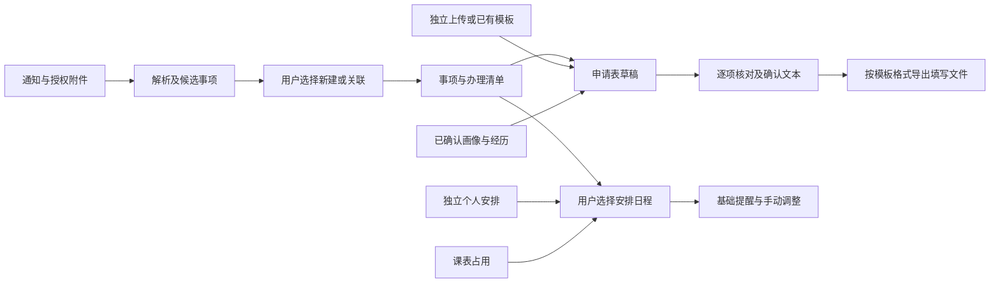

# 知事 RuleFlow 后续功能开发指导

更新日期：2026-11-03。适用工程：`SI/RuleFlow`。

本文统一后续产品行为、数据边界和开发依赖，供团队及 Codex 编码任务使用；不是实施完成报告，不含人员分工和周排期。本次仅编写文档，没有执行功能开发或重新验证全部测试。最新用户需求优先于此前功能介绍和计划；历史报告只能证明当时列明的范围。

**这是一份持续使用的开发指导文档，需要保存完整的产品行为、功能细节、技术设计和边界，功能可以循序渐进实现。**本文记录完整目标及依赖，不要求一次开发或一个六周周期完成全部能力；具体阶段范围由另行确认的实施计划决定。分阶段只调整实现顺序，不自动取消已确定需求，也不能把未实现的设计当作完成事实。文中“本轮／首版”用于说明当前重点或最小验证边界，不作为整份文档的有效期与全部功能的交付期限。

状态约定：**已确定需求**表示产品目标；**现有实现**表示有下列源码依据，不等于真实部署验收通过；**推荐方案**表示尚需接口评审的技术建议；**待验证**表示缺少实现或运行证据；**后续可选**不得自动进入本轮范围。代码路径均相对仓库根目录，新增实体和能力名称均为设计名称，不是已经存在的 API。

## 1. 项目定位与完整业务流程

知事是面向 Android 的校园事务智能助手，在 Vue 3 / TypeScript / Capacitor / FastAPI 工程上增量开发。AI 负责自然语言理解、复杂语义提取和文字生成；传统算法负责规则计算、结构化匹配、检索与排程优化；程序同时负责数据管理和文件处理；用户负责最终确认与实际办理。这是业务内部的职责划分，不是三套独立系统。

产品重点是帮助用户实际推进和完成校园事务，通知与资料管理服务于后续办理。当前不开发电脑端或复杂跨设备同步。跨平台学习资料管理仅作为未来展望；若将来扩展电脑端，应按手机随身获取、提醒与办理、电脑适合的集中编辑等场景论证分工，不为双端重复开发功能或增加用户操作负担。

**已确定需求：**通知导入 → 授权读取正文和附件 → 提取一个或多个候选事项 → 用户创建或关联事项 → 规则与个人资料核对 → 办理清单和材料准备 → 按需填表 → 按需安排日程与提醒 → 用户反馈。流程可跳过不适用步骤；导出表格、完成清单均不代表学校审核通过或官方提交成功。

办理清单贯穿材料匹配、缺项检查、填表与执行，不是必须填完表才能进入的下游步骤。软件协助用户推进流程，实际提交、受理和审核结果以官方渠道为准；用户标记“已提交”只记录其反馈。

独立入口同等重要：直接上传申请表、维护资料与经历、查询知识库、添加清单、创建日程、导入课表。表单草稿、个人日程和独立清单不能要求先制造一个通知或事项；后来关联事项是显式操作。

已确定的智能填表目标包括固定字段、经历复用、申请理由生成、人工修改及多格式写入和导出，DOCX 与 Excel 都是需要支持的实际格式方向。国家奖学金申请审批表作为优先代表性场景，先核实真实文件格式和版本，不预设它必然是 DOCX。不能因分阶段实施将长文本生成、基础提醒或多格式目标降为可有可无。

### 1.1 AI 与传统算法的职责

| 功能 | 主要方式与复用边界 |
|---|---|
| 校园通知理解、多事项识别 | AI 提取候选，程序验证结构、日期、证据并管理来源和确认；多事项仍需扩展单事项结果 |
| 申请资格硬性条件 | 复用 Rule AST、EvidenceRef 和三值逻辑，不让模型直接判资格 |
| 获奖、实践等经历匹配 | 已确认结构化经历的筛选与规则匹配；档案和认可范围匹配仍需新增 |
| 综合评价条件 | 资格需要依据或人工认定；申请文字可以生成通用草稿，两者不能互作证明 |
| 附件识别 | 文件签名、名称、内容结构优先；复杂类别语义才请求 AI，不能仅凭扩展名判申请表 |
| 通知去重与关联 | hash、规范化 URL、元数据，必要时文本相似度；语义相似仅作建议，不自动合并 |
| 申请表固定字段 | 已知模板映射、字段别名、类型和适用性检查；陌生歧义字段才用 AI，相关填表能力待开发 |
| 申请理由 | AI 生成可修改草稿，程序检查长度和来源，用户最终确认 |
| 材料缺项检查 | AI 随通知理解提取要求，程序匹配授权资料并展示在原办理清单；现有附件清点不足以完成适用性判断 |
| 单项／多项智能排程 | 同一传统排程能力，复用现有依赖、分段、草案和提交；扩展候选搜索及方案评分 |
| 课表／日程冲突、提醒 | 确定性时间计算和原生调度，不需要大模型 |
| 知识检索 | 复用 TF-IDF、原文摘录与引用，确有语义解释需要时才调用 AI |

程序能够可靠处理时不增加模型调用；存在复杂歧义时，也不为了省费用强行用名称规则作结论。确定性匹配无法判断就保留待确认，必要时请求 AI 并继续校验。不要求所有流程先算法后 AI：通知全文理解本来就可以先用 AI。各能力复用现有模块，不为算法另建服务，不重写规则引擎、排程和知识检索。

## 2. 现有能力与开发范围

### 2.1 可复用代码与缺口

| 能力 | 现有实现及定位 | 本轮增量／验证边界 |
|---|---|---|
| 多来源导入 | `main.py` 中 import-batches 路由；`mobile/src/features/imports`；`parsing.py` | 保留文本、URL、图片和文件解析；完善附件复用、多候选和关联已有事项 |
| 原件与证据 | `services/documents.py`、`bind_document`、documents 内容／页面接口；`parsing.py::parse_bytes` | 已有原件与行定位及 DOCX／XLSX／XLS／PDF 内容提取路径；可读取不等于能定位写入、保留格式并正确导出 |
| 附件 | `services/link_candidates.py`、`main.py::import_attachment_candidate`、`AttachmentPanel.vue` | 已有发现、逐项确认获取、父来源关系、事项补充附件；缺申请表语义分类与适用版本选择 |
| 单事项分析与复核 | `main.py::analyze_import_batch`、`services/review.py`、`AnalysisReviewPanel.vue` | 当前分析先生成一个 Case；需改为候选选择后创建／关联，保留旧记录兼容 |
| 资格判断 | `ai.py`、`rules.py`、`services/relevance.py`、`unsupported_conditions.py`；共享规则／画像 schema | 复用三值逻辑、白名单、证据校验；不另建 AI 资格判定系统 |
| 本机资料与匹配 | `clientWorkspace.ts`、`localMatching.ts`、`ClientProfileView.vue` | 已有确认、范围、有效期、冲突和 revision；尚非姓名等完整基础档案或结构化经历库 |
| 清单基础 | `bootstrap.py` 的 tasks/task_edges；`main.py::create_task/patch_task` | 复用 Task；目前强制 Case，PATCH 仅状态，需扩展独立创建和内容编辑 |
| 日程 | `api/planning.py`、`services/schedule.py`、`schedule_drafts.py` | 有 busy/course/task、分段、锁定、草案确认；缺独立日程完成语义和基础提醒闭环 |
| 课表 | `timetable.ts`、`ClientCalendarPanel.vue`、`POST /timetable/parse` | 有特定文本格式、单双周、占用展开；通用节次／学校格式不能视为已支持 |
| 知识资料 | `services/knowledge.py`、knowledge 路由、`KnowledgeLibraryView.vue` | 现有词项向量检索和原文摘录；不是已验收生成式 RAG |
| 材料文件 | vault 路由、`providers/vault.py`、`VaultView.vue` | 有 owner 隔离和事项／任务关联；与 Document 存储尚非统一去重文件系统 |
| 模型调用 | `ai.py::LLMProvider/OpenAICompatibleProvider/configured_provider` | 已有 JSON、证据校验、有限重试、usage 记录；新增能力复用此层，不起新微服务 |
| Android 分享 | `mobile/android/app/src/main/java/com/zhishi/ruleflow/` 的 ShareReceiverActivity、PendingImportStore、PendingImportsPlugin；`mobile/src/core` | 已有接收和待确认队列；构建、各已适配格式的导出交付及提醒须真机验证 |
| 填表／经历／提醒 | 当前上述模块未找到完整业务链路；package.json 未列本地通知插件 | 按新增能力设计；不得将“解析 DOCX”“资料卡”或日程页面说成这些功能已完成 |

源码定位前缀：后端文件位于 `server/app`；未写目录的前端 service 位于 `mobile/src/services`，页面位于 views 或 features，组件位于 components。测试依据可查 `server/tests/test_ai.py`、`test_review_api.py`、`test_document_api.py`、`test_attachment_upload.py`、`test_schedule_splits.py`、`test_client_calendar.py` 以及前端同名 service 测试；本文未运行这些测试。

### 2.2 范围优先级

当前确定的开发方向：已有导入与规则修复；通知／附件／事项关系；材料匹配和缺项检查融入原办理清单；清单与日程语义统一，支持用户主动使用单项及多项智能安排；课表可靠导入；画像和经历复用及资格适用性核对；多格式智能填表（含通用申请理由）；一个可靠模型服务；Android 基础提醒和文件交付。智能安排是必须提供的能力，是否使用由用户选择。填表先以核实后的真实代表性模板建立完整闭环，再逐步落实其他格式适配；具体批次安排不在本文承诺。

后续可选：更广的学校与模板覆盖、语义检索增强、备用 Provider、LoRA/QLoRA。DOCX／Excel 多格式写入属于确定目标，不归入可选项；XLS 旧格式和不同 PDF 类型的具体交付方式须评估。暂不必做：从零训练、官网爬虫及监控、后台主动检测及自动重排、对任意格式任意复杂版式无条件通用填表、第三方自动登录／提交、独立桌面／iOS／鸿蒙、复杂多端同步、独立隐私脱敏工具。保留旧平台目录不代表继续投入开发。

创新从真实场景、应用模式和可验证的技术实现中提炼，优先展示信息复用、状态衔接和用户完成事务的价值。保留 Rule AST、三值逻辑、DAG、启发式排程及单项／多项候选搜索和评分，不为了创新再加未经论证的算法。更复杂的事务编排、跨事务变化传播及增量优化可留作研究；已有用户主动修改草案、固定部分结果和重算其余任务仍是确定需求，不能被移到未来研究中。

## 3. 通知、附件、规则与事项管理

### 3.1 当前数据流及附件复用

**现有实现：**ImportBatch → import_sources → source_documents / Document → 按 Case 绑定 Evidence → AIAnalysis → Review → 确认生成 Task。`analyze_import_batch` 使用批次的单一 `case_id`，在分析时插入 review 状态的 Case；Review 的候选主要是行动与日期，不是多个候选事项。

URL 来源保存 final_url、document_id、附件候选；`import_attachment_candidate` 要求 `consent=true`，复用 URL 获取入口，给子来源写 `parent_source_id`。已有 `case_attachment_documents` / `case_attachment_links` 支持事项附件及未读取链接，不能把发现链接计为取得内容。来源页与 `AttachmentPanel.vue` 是前端协调入口。

**已确定需求：**优先复用通知内申请表。推荐按以下步骤实施：

1. 原文和附件候选一并展示，标清哪些仅为链接；用户确认获取范围后访问。可以提供批量选择 UI，但服务端仍逐项校验和记录结果，不默认扩大授权到未知附件。
2. 复用 `link_candidates.py` 的发现结果和受限 URL 获取；登录页、403、跳转失败、HTML 冒充附件分别提示，提供手动下载后上传，不代取登录凭据或绕过权限。
3. 文件解析通过后，优先结合签名、名称、正文表头和内容结构生成“申请表／说明／证明／未知”的分类候选；仅复杂或歧义语义使用 AI。用户确认类别及适用申报类型；扩展名不能替代签名校验或分类依据。
4. 填表入口按事项关联列出已取得模板及版本；没有模板、不可读或用户换模板时才上传。多个模板不可静默选第一个。
5. 保留原 URL、父来源、抓取时间、文件 hash、原件 ID、解析状态与错误码。Android 仅分享 URL 时如实显示没有实际文件。

### 3.2 多候选事项与多来源关联

**冲突：**单一 batch.case_id 和 Evidence 的非空 case_id 无法直接表达“未创建事项的候选”“同一来源产生多个事项”。仅给 UI 增加选择框不足以解决存储关系。

**推荐最小方案，需迁移评审：**

- 在导入层增加版本化的候选结果记录（建议名 `CaseCandidate`），保存候选 ID、标题、类别、来源／行引用、附件适用范围、分析版本和处理结果；不把候选塞进正式 cases 冒充已创建事项。
- 复用 Document 和文档行作为创建前的依据；确认创建 Case 时由 `bind_document` 形成该 Case 的 EvidenceRef。临时 source/line 引用须经程序验证并转换，模型不得伪造正式证据 ID。
- 增加“候选／来源与 Case 的关联”，容纳多对多；旧 batch.case_id 保留兼容旧单事项结果，不直接改成数组破坏客户端。
- 同一 Document 可支撑多个 Case，文件原件不复制；各事项的证据归属、任务与确认版本各自管理。公共附件显式共享引用，类别专用附件只关联所选类别。
- 确认请求携带候选版本、所选 ID、每项新建或 existing_case_id、明确同意及幂等键。事务内校验 owner、版本、引用、重复操作；返回候选到事项的映射。该契约是建议，URL 与 Schema 在实施前确认。

重复判断分两层：同 owner 下相同内容 hash／规范化 URL 给出“已导入”提示；标题、发布单位、事件时间等用于关联建议，不能单独判定相同。URL 相同但正文变化是新版本；用户可选择创建新事项、关联已有事项或忽略，不自动合并。

补充通知先保存新来源与分析快照，比较重要日期、条件、材料要求，显示差异和冲突；用户确认后才更新有效要求并使受影响草案失效。保留旧证据和人工修改，不能简单调用现有“返回已有分析”路径当作重新解析。历史已创建事项不自动拆分，旧 ID 与任务关联保持。

### 3.3 规则、日期和输入边界

沿用 `shared/rule_ast.schema.json`、`shared/profile.schema.json`、`ai.py::validate_provider_payload/validate_candidates`。模型提取条件及 EvidenceRef／原文短引，程序验证字段、类型、操作符和引用后执行；硬条件与 action_trigger 分开，软兴趣不提升资格。

结果保留 TRUE / FALSE / UNKNOWN。缺画像、资料冲突、缺附件、无证据和无法建模条件分别提示；不支持的条件放 `unsupported_conditions`，不可借用无关字段强行计算。人工资料仅代表用户确认，不能冒充官方证明。用户纠正解析时保存用户来源和新版本，不改写原文证据。

**已确定需求：资格条件分三类处理。**

| 条件类型 | 判断方式 | 不能越过的边界 |
|---|---|---|
| 明确硬条件：年级、学历、专业、排名、课程是否合格等 | 在现有白名单能表达的范围内执行 AST，保留通知及个人事实依据 | 新条件不可硬套无关字段；缺失 UNKNOWN，不以一般性申请文字补事实 |
| 结构化经历条件：获奖、项目、实践、服务时长等 | 查询已确认经历，按类型、时间范围、级别／类别、颁发单位、角色、时长、证明和通知认可目录逐项匹配 | “有此经历”不等于“本次认可”；名称相似或未找到记录不直接判 TRUE／FALSE；缺认可范围时待确认 |
| 综合评价：思想品德、综合素质、学习态度等 | 有明确可核验标准才按标准处理，否则补充依据或人工认定；AI 可解释 | 通用文字不构成资格证明，AI 不认定学校审核通过 |

经历筛选可作为独立函数／查询逻辑放在现有业务服务内，输出匹配记录、条件依据、资料版本与不能判断的原因；不是另建资格引擎。首次匹配的事实确认与本次适用性确认分开。当前 AST 不涵盖完整经历字段，未经评审不扩张白名单；未支持条件继续进入待核对机制。未来将明确规则化的经历条件接入整体结果前，须定义与现有 UNKNOWN 汇总的关系；不能靠隐藏 unsupported_conditions 将资格提升为 TRUE。

`services/date_candidates.py::extract_dates` 已区分发布时间、活动时间、截止及未知，缺年份不补当前年；完整年份加明确时区才可处理部分具体时刻。学年、统计期间、报名截止不能混用。旧 API 文档关于“一律仅到日”的描述不完整；首版仍须展示歧义和人工确认。

文件按 `file_validation.py` 和 `documents.py` 限制签名、大小、页数、像素及 Office 展开预算。解析失败保留可管理的原件和原因，不伪造成功；来源移除和原件删除是不同动作。

外部正文、附件、知识内容都是数据。把它们放入独立数据段，明确来源；不得允许其中“忽略规则、读取其他账户、调用工具”等文字改变系统权限。模型无数据库写权限、文件路径访问或任意 URL 执行权；输出的链接仍经过既有网络校验。日志只记录安全错误码和 ID，不回显原文或密钥。

### 3.4 材料要求与附件清点的区别

**现有实现：**`ai.py::MaterialCandidate` 主要保存 title/state 及继承的证据字段，`schemas.py::MaterialIn` 只有 title/evidence_ids；`services/attachment_requirements.py::inventory` 按原文附件引用、编号／名称匹配 Document，返回 obtained/failed/missing 并明确“名称匹配不代表适用”。它解决附件是否取得，不是完整的申报材料适用性检查。

**已确定需求：**在通知理解时提取材料名称、必交／条件性／选交／无法确定、适用条件及原文依据；格式、有效时间、电子／纸质提交、签字盖章仅在通知有明确要求时填写。例如“家庭经济困难学生需提供证明”应保留条件，不能展开为所有人的必交项。条件不明与材料缺失是不同结果。

**推荐最小扩展：**在现有 materials 及其候选 Schema 上增加可选的要求分类、适用条件、约束及要求版本；旧数据默认“未分类／待核对”，不能默认必交。条件可表达时复用 AST，否则保存有依据的未建模条件。字段细节和迁移仍待评审，本次不修改 Schema。材料原始要求、解析候选、用户修正分别保留来源，材料规则更新使相关匹配／清单提示复核，不覆盖原通知。

## 4. 办理清单、日程及课表

### 4.1 复用实体，而不是增加第二套任务系统

| 概念 | 现有基础 | 推荐语义与必要扩展 |
|---|---|---|
| 事项 Case | 一个事务及来源、规则、截止、材料 | 管理办理背景；不要求所有个人操作都属于 Case |
| 清单项 Task | tasks；todo/in_progress/done/skipped；task_edges | “要做什么”；复用原 Task、材料和依赖，新增手动独立创建及内容编辑 |
| 日程 ScheduleItem | schedule_items；可空 case_id/task_id；busy/course/task | “什么时候做”；独立个人安排不要求 Task；需要完成、优先级、提醒等增量字段 |
| 课程占用 Course | 本机 courses，展开为 calendar_blocks | 是时间约束，不是待完成清单；不自动变为服务器课程副本 |

`bootstrap.py` 中 tasks.case_id 和 evidence.case_id 为 NOT NULL；`create_task` 必须 Case、Evidence 和 review confirmed；`PatchTask` 只有 status。独立清单需要真正的兼容改动，不能创建隐藏“假事项”掩盖此问题。

**推荐方案：**继续使用 Task，评审后允许 case_id 可空，增加来源类型（用户手动／通知确认）及用户填写的证据记录；相应扩展证据归属以支持 owner 下无 Case 的输入，不建立平行事实引擎。仅手动独立清单绕开通知 Review 门禁，仍要输入校验和明确保存；通知清单保留原确认门禁。需要盘点 Case 假设涉及的 SQL、统计、DAG、导出、权限和迁移，采用备份、可回滚迁移及旧数据回归后落地。不能仅放松请求 Schema。

现有独立 busy/course 日程不要求 Case，但 task 类型强制 task_id；它并不是已经具备完成状态的个人日程。推荐在原日程结构增加可独立的个人事件类型与状态／优先级，兼容 busy/course，具体枚举待确认。

### 4.2 状态与删除规则

以下是**推荐方案，双向同步尚未定案**：

| 操作 | 建议行为 |
|---|---|
| 清单加入日程 | 引用同一 task_id，不复制 Task；带操作幂等键，重复点击返回原安排；增加时间片须显式操作 |
| 一项多个安排 | 复用 splittable 和已有分段草稿。当前普通 POST 对已有安排通常拒绝重复，不能假设任意多次 POST 都支持拆分 |
| 清单完成 | 更新办理进度；相关日程显示“关联清单已完成”，取消未来提醒，保留历史时间；不把每个时间片都伪造为实际执行完成 |
| 日程完成 | 记录本次时间段完成；提示是否同时完成清单，不默认全部双向同步；单片结束不自动完成多片任务 |
| 删除日程 | 只移除时间安排和提醒，清单保留；现有依赖／锁定限制仍须尊重 |
| 修改安排时间 | 不修改事项或清单截止；超截止、课程冲突、前后依赖冲突先提示并按明确规则阻止保存 |
| 跳过清单 | 保留 skipped 与 done 区别；当前依赖算法把 skipped 视作可继续，需要产品确认是否沿用，不能默认为已办理成功 |
| 删除清单 | 先展示关联日程和材料影响，由用户选择处理；不级联删除原件 |

页面整体按“办理清单＋日程”梳理入口和状态，复用 `features/planning/PlanView.vue/PlanSchedule.vue` 的功能。不是在旧任务系统外再放一个互不关联的清单。简单事务可只有一个清单项，不强制复杂 DAG。

### 4.3 课表、提醒与调整

`timetable.ts` 已有固定文本格式解析、学期起止、周次／单双周、取消日期、课程冲突与最长 90 天占用展开；`POST /timetable/parse` 返回待核对文字，不自动建课。先保留现有文本／文件流程，完善导入预览和修正；节次映射要由用户指定作息表，不能猜第几节的实际时间。重导入先比对、预览新增／替换，不覆盖手工修正；学期冲突分窗口验证，不将一次 90 天结果声称为全学期。

服务器排程只接收获授权的占用时段及 calendar_revision，不必课程名称。课表更新使旧草案过期；保存占用快照后再提交，拒绝以旧 revision 覆盖新课表。

**已确定需求：Android 基础提醒＋手动调整＋用户可选用的单项／多项智能安排。**两种智能安排均在本轮范围，提醒、冲突、排程计算走程序，不调用模型。截止是最迟办理时间，日程是执行起止，提醒是触发时间，分别保存。

推荐建立设备本地 reminder_id ↔ 日程 ID／版本的映射，取消、改时、完成时撤销旧提醒再按新版本建立；应用启动时核对本机提醒与已保存日程，避免重复。通知拒权不阻止保存日程，显示“未启用提醒”并提供设置入口。到期离线仍能触发已调度提醒；普通退出、进程被回收、重启、改时区与系统节电分别真机验收，强制停止等系统限制如实提示，不能承诺绝对准时。选型需验证与 Capacitor 6 兼容、Android 权限及重启恢复，当前尚无完整实现证据。

排程建议复用 drafts/commit，确认前不改变现有安排。首版用户手动改时、更新进度或主动请求新建议；不要求后台监控、自动重排，也不把“AI 调整”作为每次日程操作的依赖。

### 4.4 单项与多项智能安排

**现有实现：**`SchedulePreviewIn.task_ids` 与 `planning.py::schedule_preview` 已能选择一个或多个任务，统一调用 `schedule.py::preview_schedule`；空 task_ids 会查询当前范围内未完成任务。因此单项可以复用长度为一的集合，选定任务入口必须明确传 ID，不能把误传空数组当“无选择”而安排全部任务。现有接口还要求关联 Case 已确认，独立 Task 的支持依赖第 4.1 节兼容改动。

| 当前可复用部分 | 代码行为及限制 | 最小扩展方向（推荐，尚未完成） |
|---|---|---|
| `_sort_tasks`、`preview_schedule` | 拓扑排序；就绪任务按紧急性 .40、重要性 .30、依赖压力 .15、偏好 .15 排序 | 保留可解释评分；现有 preference 是任务标量，不等于晚间等具体时段偏好 |
| `_first_slot` | 找最早可行时间；30 分钟步长、同日工作时段、缓冲及每日任务时长限制 | 有界枚举可行候选，按完成早晚、负担和偏好时段评分，不能只改任务排序就声称多方案 |
| 分段逻辑 | 用户允许时按最小／最大片段分配，安排不全则撤销该任务本次全部片段，返回 unscheduled | 增加最大拆分次数约束和多候选比较；保留任务内片段顺序，不强制拆分 |
| 已有占用和依赖 | 课程／日程参与占用；当前所有正式安排均保留，不仅锁定项；done/skipped 均放行依赖 | 保持正式占用不动；审查 skipped 及未选前置任务已有时段是否覆盖完整耗时 |
| `schedule_drafts.py` | 不可变草案、owner 状态指纹、calendar_revision、确认幂等；提交重新校验并原子写入 | 草案编辑／固定部分结果／重算其余需新契约，不能直接修改旧快照 JSON |

**已确定行为：**单项从清单点击“智能安排”，按时长、截止、课表、已有日程、锁定、可用时间和偏好提供若干实际可行的候选时间；用户可选、可改、可取消。多项选择一组任务，输出一套或少量可比较的整体草案，考虑依赖、拆分、优先级和每日负担。两者共用“约束过滤 → 候选搜索 → 评分 → 预览 → 用户确认”的能力，不另写两套求解器。

推荐先给现有搜索增加有界候选枚举及配置化评分。尽早完成、均衡负担、偏好时段可作为同一搜索器的策略配置；不要求三个独立算法，也不要求一次实现任意复杂偏好。对候选时间片集合去重，只存在一个可行方案就显示一个，没有就返回原因；不能凑数。评分只比较满足硬约束的方案，权重和规则版本可追溯，不显示无依据的“智能程度百分比”。

推荐解释直接来自计算结果：为何选此时段、检查了哪些课表／日程版本、截止余量、偏好命中、每日负担、未安排任务与原因；方案间展示完成时间、分段数及负担差异。当前 reason=earliest_available 不足以覆盖这些解释，需扩展结果 DTO；统一响应是否增加方案集合／选择 ID 须兼容旧 suggestions 消费者，不直接换掉现有形状。

### 4.5 排程边界和草案修改

| 边界 | 现状与本轮要求 |
|---|---|
| 预计时长 | 当前未知时长可回退 30 分钟，不能据此认为用户已确认。显示可修改建议，正式确认前核对；记录估计来源。已有安排时 `update_task_planning` 会拒绝直接改时长，需设计变更预览或保持显式移除后修改，不能静默丢弃安排 |
| 起止／时区 | 当前默认从 now 搜索 14 天，最多 90 天，但显式传过去的 window_start 未见统一夹紧；扩展时拒绝过去输入或明确调整到 now，提交前再检查已过时建议。无截止也要有搜索上界；纯日期按选定时区解释，不混淆安排与截止 |
| 具体时刻／跨天 | `parse_instant` 要求时区，而 `_deadline` 对无时区时刻会用参数时区；写入校验部分采用 Asia/Shanghai，须统一预览和提交口径。当前工作窗口不跨午夜；跨天任务通过用户允许的分段安排，不把跨午夜单段当已支持 |
| 依赖 | 沿用 DAG，先完成 PPT 再录制视频；选中集合外的前置不能消失。预览与提交的前置耗时判断需一致。skipped 不等于实际完成，必要依赖是继续阻断还是经用户明确豁免须评审，不能仅改 UI 文案 |
| 拆分 | 用户选择可拆／不可拆、最短连续时长、最大片段及允许拆分次数；现有 min/max 为 30 分钟倍数，最大拆分次数尚缺。不可拆就不强行拆，尾段不足和碎片过多须解释 |
| 硬约束／软偏好 | 截止、必需依赖、课程和不可移动安排为硬约束；时段偏好、尽早和均衡为软偏好。用户设定的可用时间、每日上限按约定作硬限制，负担均衡另作软目标；不能为评分越过限制 |
| 无法全排 | 返回部分可行草案及未安排原因：前置阻断、过期截止、占用／可用窗口不足、拆分限制等；可提示调整时长、范围或已有安排。当前单个任务片段不足会整体撤回，不把其残片冒充完整安排 |

**用户控制与最小兼容建议：**

- 手动新建／编辑始终可用；用户触发智能安排，选择某方案后才能确认，计算或取消不修改正式日程及清单。
- 在草案内改时或固定部分任务／时间片后，按相同约束验证，将固定片段作为临时占用，仅求解剩余任务和剩余时长。固定片段与正式占用分别计数，避免重复扣减；保留依赖顺序。
- 当前 `schedule_locks` 面向正式 item_id，不是草稿中的 task_id。推荐在草案结果中保存固定片段和版本，重新生成不可变草案并使旧版本不可提交；固定范围、方案选择及修改请求均须服务端复核，不直接信任客户端时间。
- 现有正式安排（包括未锁定项）默认都不搬动；用户主动移除／修改已有安排后重新计算。任何未来替换安排都需显式列出影响，不能先删正式数据再尝试求解。
- 提交复用 `commit_draft` 的 owner、状态指纹、课表版本、锁定和事务校验；增加候选／编辑版本核对，所有失败保持原日程不变。用户修改约束后重新计算、显示冲突，删除时间安排仍不删除清单。

### 4.6 材料匹配直接融入办理清单

**已确定需求：**用户确认事项后，用已确认材料要求对授权可用的通知附件、事项附件、Vault 和经历进行确定性匹配，结果直接显示在同一事项的办理清单；正常不再要求点击一次 AI 分析。无权限的文件／远程附件先申请必要授权，不能把自动检查解释为静默读取或抓取。

现有 `materials` 与 `task_material_links` 已表达材料要求和 Task 关系，`review.py` 会按材料标题包含于行动标题建立链接，`main.py::task_dtos` 聚合材料和文件；`vault_case_links/vault_task_links` 可复用。标题包含只能粗关联，不能证明材料适用、条件成立或已完成。

推荐在原 materials 要求记录上补第 3.4 节字段，用轻量的材料匹配关联保存 requirement_id、文件／经历引用、候选或确认结果、依据／原因、资料与要求版本、用户修正及线下准备标记；是否扩展现表或增加关联记录待迁移评审。继续用原 Task 表示办理进度，不新建“材料准备清单”或平行任务表。一个要求可有多个候选，一个文件可支撑多个要求；用稳定要求 ID＋task_material_links 幂等关联已有清单，需要新操作时才提出待确认 Task，不因每次检查重新建任务。

| 维度 | 产品语义（具体枚举待协调） | 不允许的等同 |
|---|---|---|
| 材料匹配 | 找到候选、已确认适用、待核对、当前未找到、不适用或无法判断；不适用须与未知分开记录原因 | 找到申请表≠已填写；取得证书≠本次认可；未找到≠用户没有 |
| 办理进度 | 继续复用 todo/in_progress/done/skipped 及对应展示 | 上传、匹配或导出≠官方提交；候选命中不自动改 Task 为 done |

匹配先检查要求是否适用，再按类型、名称、申报类别、时间有效性、来源和结构化属性查找，未知条件保留待核对，不计成明确必交缺失。表单候选匹配后直接显示填写入口，多个类别绝不默认选第一个。经历可以提供证书关联或佐证候选，经历文本不能替代通知要求的正式证明。

用户可查看通知依据，选取／更换材料，上传文件，标记“已线下准备”，纠正匹配，增加自定义办理步骤或修改进度。线下准备是用户声明，签字／盖章等仍需核对；查找结果不被改成“文件已上传”。用户改动保留独立来源，不改原文；删除 Task 只处理关联，不删原件。要求更新时重新匹配受影响项并提示复核，保留人工选择、历史来源与办理记录。独立填表无通知要求时跳过这项通知驱动检查，不因此阻断填表。

## 5. AI 申请表填写

### 5.1 模板和字段映射

**已确定需求：**智能填表面向不同格式的实际申请表，需要逐步支持 DOCX、Excel 等文件的写入与导出，不只是读取或识别。入口保留通知附件、事项附件、材料库和独立上传；每个入口明确当前格式能否解析、填写及导出，不因来源不同再建一套流程。国家奖学金申请审批表是优先代表性场景，其原始格式、年份版本及实际提交要求必须先核实，不假设一定为 DOCX。

推荐流程：授权读取原件 → 对应格式适配器提取结构和可填写位置 → 共用业务层分级匹配字段并核对歧义 → 选择适用资料 → 填写草稿 → 核对／修改／确认 → 格式适配器写入并导出。不是每份表都要调用 AI；需要模型时只返回 field_id 与语义，不生成可执行 XML、公式、路径或文档操作脚本。

**已确定的两层设计：**

| 层次 | 职责 | 边界 |
|---|---|---|
| 通用业务层 | 字段语义及三级匹配、资料适用性、经历复用、长文本、草稿版本、用户编辑与确认、来源和授权 | 以 field_id 管理填写值，不依赖具体单元格坐标；不同格式共享同一业务模型和 Provider |
| 格式适配层 | 格式识别及能力检查、原始结构解析、受控位置定位、保护区域、写入、版式／结构验证及导出 | DOCX、XLSX 等保留各自定位与格式规则；只使用已确认值，不重新生成文字或修改资格结论 |

实现可从现有服务内的少量函数／适配类开始，不需要插件平台、新微服务或第二套 AI 调用链。适配器输出字段位置集合及约束，业务层产生确认快照，适配器验证 template hash／mapping revision 后写入。已有纯文本提取接口继续服务通知与证据；不要为填表将其返回结构直接替换而破坏调用方。

**已确定的三级策略：**

1. 已知模板：核对 hash、结构和版本后直接用已确认字段／单元格映射，无模型调用。
2. 字段别名和类型：例如所在院系↔学院、专业名称↔专业、联系电话↔手机号码；结合所在表区、填写对象、数据类型与上下文约束匹配。学生联系电话与推荐人联系电话不能仅按相似标签填同一值；歧义不强选。
3. AI 辅助：陌生、复杂或不确定字段才发送必要表格结构和上下文，程序校验建议位置在允许集合内，并让用户核对歧义。确定规则和模型都无法判断则保留未匹配。

三级处理属于共用业务策略，位置校验由相应格式适配器负责；不是每种格式重新实现字段理解。当前完整模板映射、别名算法和填表持久化均仍待实现。先围绕核实后的国家奖学金等真实模板验证，随后逐步扩展格式与模板覆盖，不承诺任意复杂版式都能正确写入。

建议新增最小的 `TemplateMapping` 和 `FormDraft`：前者解决原表格位置与语义对应，后者保存人工修改及确认快照；现有 Case Review 面向任务，不应塞入表单状态破坏契约。

| 建议结构 | 必要内容 |
|---|---|
| 模板映射 | template_document_id、文件 hash、源格式、模板类别／版本、mapping_version、适配器及定位版本、字段 ID、格式专用受控位置、类型、字数／空间约束、禁止填写区域 |
| 表单草稿 | owner、可空 case_id、模板／映射版本、revision、共用字段值及来源、选择的经历 ID／版本、长文本、手工修改标志、确认快照；用户选择的输出格式与转换选项 |
| 导出记录 | 草稿确认版本、原模板 hash、输入／输出格式及 MIME、生成文件 ID／hash、适配器／生成器版本、转换与保真限制、导出时间、可选事项／材料关联 |

合并单元格可导致逻辑坐标别名，须先标准化位置并用真实模板验证；不能用全文替换去填相同标签。识别模板版本用内容 hash 与结构检查，不能只按文件名。映射只复用结构，私人填充值不跨用户共享。

位置描述按格式区分：DOCX 的表格／段落／单元格，XLSX 的工作表和单元格／合并区域，PDF 的真实表单字段或经核对的位置。不要强行把所有格式压成一个行列坐标。跨格式转换后视为派生模板，记录原件关系并重新校验映射；相同字段语义可以复用，原位置不能直接沿用。所有上述字段均为推荐结构，现有接口和 Schema 本次不变。

### 5.2 固定字段与经历

字段明确区分：已确认且适用的事实、缺失、冲突／过期／未确认、禁止填写。姓名、学号、成绩、获奖等没有可靠来源时留空提示；院系审核意见、签名、盖章区始终保留空白。模板示例值只是模板内容，既不是用户事实，也不进入经历库。

字段位置正确不代表值适用：排名要核对学年、专业／班级等统计口径及分母含义；获奖要核对时间、类别和认可要求；学院专业要核对版本和生效时间。先取第 6 节有效资料，再按字段要求过滤；信息缺失或冲突仍提示补充。经历名单字段可按时间等结构化筛选，不必每次让模型重判；匹配事实与资格认可也须分开。

资料与经历由用户选择，草稿每项保存来源引用和版本；用户编辑值设为手工版本，后续重新匹配只提出差异，不覆盖。确定性字段优先直接匹配，无须每次调用模型。资格规则和个人填表事实分离：姓名、手机号等不因为要填表就加入 Rule AST 可执行字段。

### 5.3 申请理由生成是已确定能力

**已确定需求：通用表述＋可选真实经历＋用户编辑确认。**没有大量经历或证明文件也可以生成基础草稿；输入包含模板要求、目标字数、用户表达意向，以及按需选择的已确认事实／经历和必要通知依据。推荐输出 `{text, used_fact_ids, used_experience_ids, warnings}`，允许来源数组为空并标明通用草稿，这是新增能力 DTO 建议，不是现有接口。用于生成的个人事实 ID 与通知 EvidenceRef 各有命名和校验，不能混为官方证明。

- 支持约 200 字理由及模板实际要求；字数统计口径和空间上限在模板配置中明确，程序检测超长后提示精简，不直接截断。
- 生成或重新生成仅由用户主动触发，显示用到哪些事实／经历；来源 ID 有效仍不保证语义无杜撰，需核对每个新增成绩、荣誉、数量和时间。
- 无具体经历时可生成积极进取、持续学习和未来努力方向等通用表述；涉及个人当前表现的陈述交用户审核，不声称系统已验证。涉及成绩、职务、历史获奖、项目成果、志愿时长等具体事实必须有来源，不编造“多次获国家级奖学金”“志愿服务200小时”。资料不足仅阻止相关事实性陈述，不阻止通用草稿；也可提示补充或自行写。
- 保留生成版本和当前人工修改版本；重新生成先预览，用户接受才替换。
- 导出读取用户确认的文本快照，禁止导出时再次调用模型生成新文字。

通用评价文字即使由用户确认，也不是学校资格认定或证明材料。不得把生成结果自动反写为画像事实／经历，再用于资格匹配形成循环佐证。

### 5.4 格式适配、写入与导出

**现有实现依据：**`server/app/parsing.py::parse_bytes` 用 python-docx 提取 DOCX 段落和表格行，用 openpyxl 的 `read_only=True, data_only=True` 提取 XLSX 工作表值，用 xlrd 提取 XLS 单元格值；PDF 提取文字／坐标并按需 OCR。`services/file_validation.py` 已有这些格式的扩展名、签名或容器及资源预算检查。它们可复用作输入校验、内容理解和证据处理；未形成模板定位、保真写入和确认后导出的完整链路。

| 格式 | 写入与导出设计参考（待实现／验证） | 明确限制 |
|---|---|---|
| DOCX | 保留原受限 OOXML／DOCX 方案；定位表格、段落、单元格及占位内容，只修改用户填写区域；保留合并、主要格式和可编辑性 | 文本提取不提供完整写回定位；真实模板须验证合并、长理由、分页和 Word/WPS 编辑；未知复杂结构不静默重建 |
| XLSX | 从原工作簿读取完整可写结构，定位工作表、单元格及合并区域，保护公式、格式、数据验证、行列布局及打印设置；写入确认值后输出新工作簿 | 现有只读且 data_only 的提取结果不能作为公式保真写回依据；公式单元格不作为普通填空覆盖。学号、手机号等明确按文本处理，避免丢前导零；用户文字不执行为公式。不得承诺库已重算公式，需核验 Excel/WPS 中的结果与打印效果 |
| XLS | 已有 xlrd 内容读取，可复用理解结果；旧格式原位写入与转换到 XLSX 两条路径按真实模板评估 | 不直接承诺保留全部旧格式特性；转换须保留原件、记录输出格式和损失，核实提交方是否接受，并由用户选择；不能只改扩展名 |
| 可填写 PDF | 先检测真实表单字段、类型、只读属性，映射后写入并核对字段值及显示；明确输出是否仍可填写 | 现有 PDF 文本／OCR 解析不等于表单填写；不得自动填写签名／审核区域或破坏已有签名，复杂表单先报告不支持 |
| 普通 PDF／扫描件 | 分别评估可核对的位置写入或转换方案；扫描件的 OCR 只用于候选理解，位置和效果需人工检查 | 没有现成表单字段，不假设能直接编辑；叠加文字不等于可编辑原文，不能默认承诺可编辑导出。暂未适配时保留原件和填写草稿，明确不能自动写回 |

DOCX 和 XLSX 的写入／导出都属于确定的多格式目标，可以按真实模板分阶段落地；XLS 和各类 PDF 的实现方式、支持粒度与优先级待验证。其他格式按实际需求评估，不因文档列出方向就宣称全部可用。库选型、版本兼容及模板保真需技术验证，本次不安装或升级依赖。

每种格式分别记录“可读取内容、可定位字段、可写入、可正确导出、输出可编辑性及适用限制”，不能只标一个笼统的“支持”。优先保持原格式；任何格式转换须告知输出类型和可能损失，核对通知的提交要求，不能由系统自行保证被学校接受。

原模板只读，输出新文件；导出幂等依据包含确认快照、模板／映射版本、输出格式、转换选项及适配器版本，重复导出不破坏原件。输出重新打开检查结构和关键值，并预览或人工检查版式；长内容溢出时提示修订，不静默截断或缩到不可读字号。各格式都验证空字段、保护区域、特殊字符、重复导出和适用的编辑／打印操作；公式与宏、外部链接等非填写内容不能由模型或用户填充值触发执行。

服务端提供 owner 授权下载，Android 按真实扩展名和 MIME 获取、保存／打开／分享已适配格式的文件，可按用户选择关联 Case 和材料库。无事项的 FormDraft 同样能导出；稍后关联只添加关系。导出失败或暂不支持该格式写回时保留已确认草稿，不能要求重新填写或返回假成功文件。保留“文件已生成，尚未向学校提交”的明确状态。

### 5.5 分阶段适配与代表模板验证

先收集通知实际附带的申请表，记录原始格式、版本、来源、申报类别、填写／提交要求和受保护区域；再验证读取、定位、写入和导出可行性。国家奖学金表可能是 Word 或 Excel 等格式，不能先改造成 DOCX 再声称支持真实原模板。

按样本价值、技术成本和可行性安排格式适配顺序：先让至少一种真实代表模板跑通解析、资料匹配、文本生成、用户确认、写入、导出及 Android 交付；随后利用共用业务层逐步支持 DOCX、XLSX 等其他格式。若阶段只完成一种，应记录其完整验收范围和其余适配状态，不取消多格式需求，也不承诺全部格式在同一周期完成。原 DOCX 方案继续保留为具体适配设计，不再作为所有申请表的统一格式约束。

## 6. 画像、经历、知识库、材料库与存储

### 6.1 当前分布与复用边界

| 数据 | 现有保存位置／依据 | 推荐复用方式 |
|---|---|---|
| 本机画像／资料卡／课表 | `clientWorkspace.ts` 的 IndexedDB `zhishi-private-client`，Workspace v2，按 owner 分区及 revision 提交 | 扩展同一本机工作区的版本化档案，避免新建平行 store；保留备份／旧版迁移能力 |
| 旧账户画像、事项事实 | 服务端 SQLite facts、画像版本／历史；旧 Profile API | 明确与本机资料的关系；当前本机不自动 PUT；不以偷偷同步解决显示差异 |
| 事项、规则、任务、日程、分析历史 | SQLite；bootstrap/migrations、review、schedule_drafts | 按 owner 和版本引用，保持旧 ID 及历史 |
| 通知原件及行 | Document 存储目录与 documents/document_lines 相关表 | 正文证据、附件、模板使用同一 Document 引用 |
| 材料库文件 | Vault metadata＋`providers/vault.py` 管理的服务端文件目录 | 不能把 provider 名为 local 解释为存在用户手机上 |
| 知识索引 | `services/knowledge.py`，用户私有文档／片段及行引用 | 用户明确选择才索引，证书入材料库不等于入知识库 |
| 经历、表单草稿／导出 | 没有完整现有实体 | 推荐经历默认扩展本机工作区；服务端只接收授权快照；草稿持久位置需确认，不能默认全量云同步 |

不要擅自把全部本机数据迁到服务器，也不能宣称全部数据不离开手机。退出登录清理本机资料的现有行为（账户状态与 clientWorkspace 调用链）会影响经历／草稿保留，扩展前必须确认退出、卸载、清理和备份体验。

### 6.2 画像完整性必须按当前用途计算

`shared/profile.schema.json` 是现有规则事实白名单，不含完整身份字段。`resolvedFacts` 只使用已确认、未过期、scope 匹配的 assertion，冲突值不输出；`matchLocal` 还综合规则证据、缺附件和 unsupported_conditions。`ClientProfileView` 保存 form 后创建 assertion，旧账户迁移的 assertion 为未确认。

服务端 `/profile/completeness` 使用 `required_profile_fields` 和服务端 `profile_values`；`MeView/ProfileView` 等仍有该口径。它不是本机画像当前事项的完整性。针对性阅读 `ImportView` 与 `AnalysisReviewPanel` 未发现全局完整度直接阻断导入／确认的依据；“不断提示补充”的具体入口与账户状态仍需复现，不能凭症状认定已定位全部原因。

推荐统一消费“当前事项规则／表单字段的需要集合”及同一版本的有效资料；返回缺失、未确认、过期、冲突、范围不适用等原因。已有有效资料即时反映，不拿全局完整度作为所有功能门禁；某份表缺手机号不使整份画像失效。保存或切换账户后重新加载对应 owner／revision，避免 UI 使用旧请求晚返回覆盖新状态。按普通、过期、冲突、仅本机填写、账户切换分别验证。

### 6.3 经历档案

推荐最小记录：ID、类型、名称、起止时间、角色／贡献、结果、来源文件／行、用户填写来源、确认状态及 revision。先手动填写即可使用，再接 AI 文件提取候选；候选不自动保存为已确认事实，证书 OCR 不等于真实性审核。

为结构化筛选按需补充奖项级别／类别、主办或颁发单位、服务时长及证明引用，未提供则未知，不从名称猜级别。程序按通知允许的时间、目录、单位、角色等过滤已确认经历，返回命中和不确定原因；同一经历无需反复 AI 提取。认可目录或量化标准缺失时不能仅凭“有获奖”认定符合资格，也不能因档案未记录就认定用户没有经历。相关查询／规则推荐复用现有资料版本和证据约定，但完整经历适用性匹配尚未实现，不未经评审加入 AST 白名单。

候选支持修改、确认、忽略；正式经历支持更新／删除、关联原件。与现有 Assertion 共用来源原则，但不能把整个结构化经历塞进受限规则字段。文件可先存 Document，经历仅持引用，不必等材料库整合完成。

经历变化时，把引用旧版本的未确认表单标为“资料有更新”，用户选择刷新；已确认草稿和导出保持快照，删除经历不重写历史文件。明确历史快照可能保留旧事实，提供用户管理入口，不假称删除源记录已删除所有历史副本。

### 6.4 文件引用与删除

推荐先做薄的文件引用适配（建议 `{kind: document|vault, id}`），统一 owner 授权读取和元数据，不立即迁移全部物理存储。Document 可作为表单原件或经历证明；Vault 已有文件通过授权适配读取，新增关联优先复用原件。同 owner 的 hash 可用于重复提示，不跨用户公开命中信息或复用私人生成结果。

当前两套存储可能重复上传，不能宣称已有全局去重。删除先统计引用：解除事项关联不等于删文件；Document 已有 DOCUMENT_IN_USE 拒绝；Vault 及新增草稿引用需补一致保护。被引用文件可先阻止删除或要求用户处理引用，具体策略待定；不得使已确认依据无提示失效。缺失原件显示失效引用，保留可用历史摘要，不伪造可下载状态。

同一文件引用同时服务材料匹配、经历证明、资格核对和填表，不因入口不同再上传一份。材料匹配只读取授权范围内的必要元数据和结构化信息；读取内容或发给模型超出现有授权时另行确认。文件替换、删除、经历或要求版本变化，只使相应匹配结果待复核，不自动改 Task 完成状态；线下准备记录与文件引用分开。证书既可只存材料库，也可由用户选择生成经历候选，不默认进入知识索引。

知识库资料更新保存新版本，展示生效／来源时间；旧引用保留快照。全文检索只在授权资料范围内，首版复用 TF-IDF 和摘录，不必为“AI 功能”默认发送全部库或引入向量服务。

## 7. 统一 AI 服务、模型选择与成本控制

### 7.1 业务能力不等于模型数量

多个 AI 能力接口不等于多个模型，也不等于每次操作都要调用模型。优先不调用的操作包括：已确认资料筛选、已知模板／别名映射、hash 查重、材料候选检索、确定性资格规则、单项／多项排程、冲突、提醒、日程与材料状态修改、各格式的文件写入导出。适合调用的操作包括复杂通知理解、多事项提取、陌生字段语义、非结构化经历提取、申请理由及确有需要的内容解释。附件分类先看文件特征，材料检查复用通知分析时已取得的要求，知识库先检索再决定是否解释；算法可完成的操作不能整体依赖模型服务在线。

现有 `LLMProvider.analyze(evidence)` 与 `AIAnalysis` 为单事项分析服务；OpenAICompatibleProvider 封装 HTTP、JSON 输出、长度限制、校验、最多两次尝试与 usage 信息。统一层应从此增量提取公共调用逻辑，保留现有 analyze 行为和测试；不能把五种能力硬塞进现有单事项 Schema，也不需要五家 Provider。

以下均为**推荐能力契约**，不是现有 HTTP 路由：

| 能力 | 最小输入 | 输出及校验 | 确认点 |
|---|---|---|---|
| 通知理解／多事项 | 授权 source/line 文本、附件元数据、输入版本 | candidates[]，每项复用 AIAnalysis 的 rules/materials/tasks 等结构；引用须属于输入，数量和长度有界；日期仍复用程序候选 | 选择事项及创建／关联；随后核对动作和日期 |
| 表单字段理解 | 仅未被已知映射／别名可靠解决的结构、标签、模板 hash，不带私人填充值 | field_id、语义、类型、可填／禁填、歧义；位置须在程序提取集合内 | 核对歧义；受控模板直接复用，不强制调用 |
| 经历提取 | 用户所选文件的授权文本块 | 结构化候选、source_refs、缺失字段；不能使用模板示例作为事实 | 逐条确认后入档 |
| 申请理由 | 模板约束、表达意向、可选的已选确认事实／经历快照 | text、使用来源 ID（通用草稿可空）、warnings；校验来源、长度及无依据事实风险 | 修改并确认文本，不能用作资格证明 |
| 知识辅助理解 | 检索命中的少量授权片段和问题 | 有来源摘录；生成式增强为后续可选 | 关联事项或采用建议前确认 |

调用顺序：业务服务鉴权并收集最小输入 → 复用／预算检查 → Provider → JSON Schema → 引用和业务校验 → 保存候选 → 用户确认 → 业务事务持久化。模型只返回内容，不能调用正式写入接口。

响应沿用现有 `{data, request_id}`；错误对齐现有 code/message 风格，但 `planning.py` 等部分旧错误仍是字符串，前端兼容读取，新增接口统一结构，不能宣称现有错误全部一致。定义能力级 schema_version，新增字段需版本化评审。替换模型只改 Provider 配置／适配差异，不让前端依赖厂商响应；JSON 模式不替代本地 Schema 验证。

### 7.2 候选模型与接入验证

候选为 GLM-4.7-Flash、Qwen-Flash，尚未决定接入。2026-11-02 查阅智谱官方公告将 GLM-4.7-Flash 描述为免费调用；Qwen-Flash 官方文档有模型价格说明。此处不承诺永久免费、不引用未经验证的账号额度，不认定已完成兼容或效果评测。

接入前核对模型 ID、地域、JSON 支持、思考参数、速率／上下文限制、计费和账号实际权益；不同 OpenAI 兼容服务仍可能需要参数适配。先选择一个模型跑通知、字段、经历和理由的固定评测集，比较中文语义、引用有效性、结构、延迟、稳定性及费用，再决定是否备用。

官方来源：[智谱发布说明](https://www.zhipuai.cn/zh/news/148)、[GLM-4.7-Flash 文档](https://docs.bigmodel.cn/cn/guide/models/free/glm-4.7-flash)、[Qwen-Flash 文档](https://help.aliyun.com/zh/model-studio/qwen-flash)。价格和权限在实际启用时再次核对。

### 7.3 结果复用及失效

已有 `analysis_metadata` 保存 model_id、prompt_version、parser_version、input_hash、cost_summary，批次有 revision/analyzed_revision，Review 和分析历史也有版本。它们是复用起点，不是所有能力的现成缓存。建议在现有 SQLite 增加轻量能力调用记录，先不引入 Redis／队列平台。

建议复用键：`owner + capability + 输入内容hash + 已选附件hash + 模板/映射版本 + 实际使用的资料/经历版本 + prompt/schema/parser版本 + model配置版本`；只包含该能力真正依赖的维度。调用记录存请求 ID、状态、结果引用、usage、延迟、计价版本与错误码，避免另存完整私人原文。

| 变化 | 失效范围及处理 |
|---|---|
| 正文／已选附件变化 | 通知理解和受影响草稿失效，旧快照保留；仅页面切换不触发调用 |
| 模板内容／映射变化 | 映射与填表草稿需核对，禁止套用不同版本坐标 |
| 格式适配器／输出格式／转换选项变化 | 重新验证相关定位与输出，旧导出作为历史保留；仅更换导出方式不重生成已确认理由。若转换改变字段结构，则建立派生模板映射并让用户核对 |
| 画像／经历变化 | 匹配和相关未确认表单／理由提示更新；不必重做不使用个人资料的通知解析 |
| 材料要求／候选文件／授权变化 | 只重新计算相关要求的适用性与材料匹配，用户选择待复核；不重建 Task、不无条件重调模型；撤权后禁止复用对应私有内容 |
| 排程任务／依赖／课表／正式日程／锁定变化 | 旧草案重新核对或失效，按新快照重新求解，不触发通知理解。当前 snapshot 是 owner 全范围指纹，较保守；先保留安全校验，未来缩小失效范围须同时覆盖所有实际依赖 |
| 提示词／Schema／解析规则变化 | 对应能力下次生成采用新版本；旧确认结果标版本，不自动改写 |
| 用户主动重做 | 创建新调用版本；刷新页面或网络重发不等于主动重做 |

已确认经历不重复提取；理由仅主动生成／重新生成调用；单项和多项排程、普通日程、提醒、冲突及材料状态操作不调用；知识库先检索。材料匹配复用还应包含要求版本、实际使用文件／经历版本、类别和匹配规则版本；排程草案使用任务／约束／课表与日程快照及评分规则版本，不伪装成模型缓存。缓存结果读取也要验 owner 和当前引用权限，私人结果不得跨用户共享。确认后的数据属于业务快照，不是可随缓存淘汰或自动覆盖的内容。

### 7.4 预算、幂等与失败

沿用现有有限重试，新增公共层不能叠加重试形成倍增。建议初始策略为每次操作最多两次总尝试，身份／配额错误不重试；429 遵守退避，网络超时提示上游可能已消费。相同 owner＋操作键只允许一个进行中调用；结果返回后再重发读取原结果，不能重复创建事项或重复生成文件。

对每次操作设输入／输出 token、最大总尝试和并发上限；现有长度截断重试可能增加输出预算，须计入总上限。团队配置日／月预算、用户限流及熔断；具体金额和频率待确定，预算不足时停止 AI 并保留手工流程。备用付费模型默认关闭，只有管理员明确启用且预算内才可使用，界面告知可能计费的重试／切换，不能无限自动兜底。

usage 缺失时标“未知／估算”，不写零；统计调用次数、失败、token、延迟及估算成本。缓存命中、每次 Provider 尝试、一次用户操作分开统计。Provider 超时／非法 JSON／证据无效返回安全原因；已有本地规则候选可明确标示为本地结果，长文本失败则保留手写入口，不返回 Demo 冒充。

### 7.5 隐私与未来微调

密钥仅服务端；授权应说明资料发往自部署后端还是还会转发第三方模型。字段匹配和确定性填充可在不发真实姓名等值给模型时完成；理由仅发送用户所选必要事实。调用日志不记录完整身份、原文、密钥或供应商原始异常。

保留上传确认、认证和 owner 隔离。撤销授权阻止后续读取／调用，已在途请求或已导出文件的处理边界需说明，不承诺能够撤回已经发给服务商的数据。

未来 LoRA/QLoRA 仅预留 Provider 替换点、结构化输出约定、授权评测样本及错误分类。保留通用模型基线；未来训练集与独立测试集分开，不用训练集宣称效果。当前不建训练平台、不将微调列为交付前置。

## 8. Android、服务端与数据安全

### 8.1 原生能力边界

| 能力 | 当前依据与实施要求 |
|---|---|
| 分享接收 | ShareReceiverActivity → ContentResolver 读取 → App 私有目录／PendingImportStore → PendingImportsPlugin → Vue 导入确认；私有缓存不是已上传文件，接收成功不是解析成功 |
| 文件选择 | 按系统授权读取 URI，不假设真实路径；取消、权限失效、文件过大和清理临时文件分别处理；不要为方便索取全盘权限 |
| 多格式文件下载／保存／分享 | 新增原生桥或经过评审的兼容插件；鉴权下载到私有临时文件，按真实扩展名和 MIME 通过系统保存选择器或 FileProvider 内容 URI 授权分享；逐种已适配格式验证，不把服务器路径／私有绝对路径交给外部 App。没有可打开应用时仍允许保存并给出提示 |
| 本地提醒 | 尚无完整实现证据；按第 4 节设计调度、取消和恢复，UI 展示真实权限和调度结果 |
| Vue 与原生接口 | 统一返回可区分取消、拒权、不可用、失败的结果；取消不当作业务成功，Web fallback 不代表 Android 支持 |

在真机验证冷／热启动、连续分享、仅 URL、多文件、被取消权限、DOCX／Excel 及其他已适配输出的外部打开、文件保存及通知；分别检查 MIME、文件名和内容一致，浏览器测试不能替代。Vue 浏览器预览作为开发调试入口，不据此额外建设独立桌面产品。

### 8.2 服务运行与失败恢复

前端使用 `VITE_API_BASE`，更改后重建；手机的 127.0.0.1 是手机本身，开发时用可达地址或明确 adb reverse。VITE 配置公开可见，不放密钥。依 README 显式加载服务环境，不能假设 Python 自动读取 `.env`。

现有真实分析同步执行，无可靠异步队列；不要显示虚构后台进度。页面区分上传中、服务处理中、结果未知、失败和可重试；网络中断先查询已有操作状态，再决定是否重试。服务重启留下 processing 时沿现有显式取消／重试路径处理，不伪称自动恢复。

部署须验证 HTTPS、跨域来源、认证、数据目录、数据库迁移、所有原件／Vault 文件备份及恢复、日志过滤、模型预算、生产账号策略。当前 SQLite 单实例足以作为初期方案，不预设多实例共享数据库。Windows 依赖验证不能代替 Linux／容器验证；公网服务、当前真实模型链路和新 APK 真机均需实际验收，历史模型评测不能作为本次已部署的证据。

### 8.3 独立隐私工具的实际状态

当前 `API.md` 明确记录独立 `/api/v1/privacy/analyze` 已移除；本次对前端／后端的目标搜索未找到 SafeShare 或该路由实现。共享 `privacy.py`、前端导入 Guard、Document privacy/scan 与 redact 仍在。故“独立工具已移除”不等于“全部脱敏代码已删除”，也不授权本轮删除共享保护。后续若要收窄文件副本功能，先单独确认调用方；本文不修改相关代码。

## 9. 接口依赖、开发顺序与验收

### 9.1 关键契约确认清单

| 契约 | 前置数据／用户确认 | 主要失败与协调事项 |
|---|---|---|
| 来源→候选→事项 | 来源和附件授权、分析 revision；新建／关联选择 | stale、重复、越权、附件部分失败；单 Case 旧响应兼容 |
| 条件→规则→资料匹配 | 有效 Evidence、白名单 AST、适用且确认的事实 | 缺资料／冲突／不支持条件分别显示；前后端三值语义一致 |
| 经历条件→结构化筛选→资格核对 | 通知认可范围、经历／证明版本及用户确认 | 存在事实≠申请认可；未知认可范围不自动变 TRUE，聚合机制不得绕过 unsupported_conditions |
| 材料要求→匹配→原 Task | 要求类别／条件／revision、授权 Document/Vault/经历、task_material_links | 匹配状态与办理状态分离；幂等关联不造第二套清单；线下准备、用户纠正与原证据分开 |
| Task→单项／多项草案→日程 | 明确 task_ids、时长与约束、calendar revision、状态快照、候选／编辑版本 | 多方案兼容旧 suggestions；固定片段与重算范围；不移动正式安排；提交再次校验过去时间、依赖、截止和版本 |
| Task→日程→提醒 | 手动或确认草案的正式安排、设备提醒映射 | 幂等、分段、锁定、完成语义与提醒更新；删时间不删 Task |
| 原件→经历→填表 | owner 文件引用、确认经历、授权字段快照 | 候选未确认、原件失效、资料过期；不等待完整材料库重构 |
| 模板→共用业务→格式适配→导出 | 原始格式和 hash、适配能力、格式专用位置、映射 revision、确认快照、输出格式／适配版本 | 可读取不等于可写；未知格式、版式不支持、公式／保护区、超长、stale、重复导出及转换告知；字段值契约共用，定位信息按格式隔离 |
| AI 能力→Provider→业务 | capability/schema 版本、请求幂等和预算 | 超时、限流、无效引用、重复付费；候选落库与正式确认分开 |
| Android↔Vue | 待导入队列、文件 URI、提醒 ID | 拒权、取消、App 重启、外部应用不可用；不泄露本地路径 |
| 独立入口→后来关联 | case_id 可空；关联时明确选择 | 不创建假 Case；检查 owner；不复制文件或重生成内容 |

新 HTTP 路径、请求 Schema、迁移编号在实施前由调用双方确认；本文不预占 migration 编号。沿用 owner、request_id、revision 和 EvidenceRef；手动资料／未绑定 Case 的来源扩展须明确与现有验证的转换点。

### 9.2 建议开发顺序，无人员与工期安排

以下是持续开发的依赖顺序，不是要求一次完成的任务包。阶段计划应选择具体格式／模板和验收切片，并保留尚未实现的产品目标；不能为了赶一个周期改写本文为只支持一种格式的永久设计。

算法投入遵循：先复用现有实现 → 小改满足缺口 → 新增简单、可测试的确定性匹配 → 只有证据表明简单方案不足才评估复杂优化。重点复用规则三值逻辑、课表占用、排程草案／依赖、文件 hash／来源、本机有效资料匹配及 TF-IDF。材料适用性、字段别名先做受控规则和明确未知输出；不要为展示“算法多”引入强化学习、新机器学习模型、算法微服务、大型向量数据库、全局优化平台或平行任务系统。

1. 先确认三处语义与迁移：候选事项后创建、独立 Task／证据、日程完成与提醒；收集真实模板和历史通知样本，核实模板原始格式、版本及提交要求，做对应格式写入验证。并行尽早验证 Android 文件、提醒和后端连接。
2. 建最小文件引用适配和个人资料读取契约，明确通用填表业务与格式适配边界。手动经历可先保存，模板可先独立上传，优先用一种真实模板、人工映射和手填值验证保真导出；不等待全部格式、通知多事项或 AI 完成。
3. 完善来源／附件和候选选择，复用通知提取的材料要求，在原 Task 中接入最小确定性匹配；先支持已有 Document／Vault 和手动经历，不等待 AI 提取完整经历。统一清单与日程数据、预计时长及课表占用后，复用同一求解器扩展单项／多项候选和解释，再接草案局部修改／固定与确认，基础提醒并行验证。
4. 先接已知模板和字段别名匹配，再在统一 Provider 上补陌生模板语义、经历候选及通用／事实结合的申请理由；将适用性检查、人工修改、确认快照接到已跑通的导出链路。随后按样本和成本逐步增加 DOCX、XLSX 等适配，复用业务层，并分别验证公式、合并区域、版式和输出可编辑性。经历的结构化筛选不依赖模型在线。
5. 连接通知附件模板复用、已有事项关联、材料要求变化和资料更新提示；按第 7.3 节分别失效相关匹配／草案。最后做完整场景、失败恢复和真机验收。状态枚举、草案编辑协议未确认前用固定契约样例联调，不跳过兼容评审或实施无关重构。

每项编码任务开头列：需求状态、可复用模块、拟变更接口／数据、迁移兼容、确认点、成功／失败验收。修改规则、DAG、解析器、分享入口运行相关测试，UI 状态补测试；接口变更经评审更新契约基准，不能自动覆盖指纹消除失败。保持 Offline Demo 可运行；测试范围按改动选择，不重新全面重构。

### 9.3 代表性验收场景

| 场景 | 成功路径 | 必验异常／证据 |
|---|---|---|
| A 奖学金申请 | 历史通知＋附件→候选／资格核对→确认事项→原清单材料匹配→复用适用类别的真实原模板→匹配画像／可选经历→约 200 字理由→修改确认并按已适配格式导出→按需安排日程、提醒及进度反馈 | 标历史回放，不伪装当前可报名；样本格式和版本先核实。必交／条件性／选交／未知分类；候选可选／替换／上传／标线下准备；未找到不声称没有，找到不自动完成；保留原文、禁填区和导出一致性，形成完整办理链路 |
| B1 单项智能安排 | 选择一个 Task→结合课表／日程、时长／截止寻找候选→查看差异和理由→选择／修改／确认→提醒 | 多个合理候选或如实说明仅一项／无可用时间；不排过去或截止后；模型不可用也能计算；取消或删安排不删清单，提交前不写日程 |
| B2 多项智能安排 | 选多任务→依赖排序／允许拆分→预览整体方案→修改并固定部分片段→重算其余→确认→手动反馈 | PPT 在录视频之前；不擅动锁定或其他正式安排；部分可行与未安排原因；固定片段不重复计时；课表／日程变化旧草案拒绝；检验 skipped、最大拆分数、时区和负担；不为策略数量制造重复方案 |
| B3 手动日程与提醒 | 独立新建／修改或从清单选项安排→课表检查→权限与提醒→完成反馈 | 不强制使用算法或全清单排时间；重复点击、多片完成、拒权、退出／重启分别检查；删除安排、完成状态和提醒同步按确认后的语义执行 |
| C 独立填写 | 无 Case 上传实际格式申请表→检查适配能力→已知映射／别名／必要 AI→检查资料适用性→通用或结合经历的理由→编辑确认并由格式适配器导出 | 无通知不强制材料检查；已知模板无模型调用；同名歧义、学年口径不静默错填；通用稿不捏造成就；生成／导出不覆盖人工版本。DOCX 检查结构和 Word/WPS 编辑，XLSX 检查工作表／合并／公式／格式／打印，XLS 转换及 PDF 类型分别验证，未支持能力明确提示而非假成功 |
| D 资料复用与资格 | 证书→候选核对入档→按时间／级别／类别等筛选→与通知认可范围核对→复用证明和经历 | 明确硬条件走 AST，经历事实不用反复模型判断；认可范围不明／资料缺失保持待核对或 UNKNOWN；综合评价不自动通过，申请文字不作证明；示例不入档、OCR 可改、未确认不采用，历史导出不改写 |
| E 多事项／补充通知 | 多候选选部分→新来源关联旧 Case→要求差异→受影响匹配／清单复核 | 不重复建 Case 或另一套材料清单；多个附件按申报类别选，不自动用第一份；保留用户修正、旧要求和原证据；变更只失效相关结果 |
| F 调用成本与失败隔离 | 同输入复用→仅在明确 AI 操作时调用→验证依赖变化失效及幂等 | 切页、日程算法、材料状态操作不调用模型；模型失败不破坏确认数据、不使程序功能全停；私人缓存隔离；前端重发复用操作 ID，服务端不重复发起调用／建事项，供应商超时已扣费的不确定性如实记录 |

共通异常：附件需登录／403／非文件、资料不足、非法模型输出、网络断开、服务重启、预算耗尽、文件已删除、用户取消或拒权。每次都保留已确认输入、明确状态与下一步，不悄悄执行或替用户重新付费。

完整流程验证不只检查各按钮能否运行：选一个真实代表事务，记录同一份资料是否避免重复填写／上传、复用内容是否符合当前申请、用户能否看懂依据并修正错误、事项／清单／填表／日程能否衔接。与原有人工办理方式对照记录操作和耗时、修正与中断点，不预造改善比例。创新价值从这些集成证据提炼，不另建独立展示模块；每次新增格式也须验证共享流程没有回归。

未来验证记录应含样本来源、人工标注、版本、设备／环境、预期与实际、失败分类。模型结构合法率、语义准确性、证据有效性和用户修正分别衡量；性能记录上传／解析／模型／导出分段耗时及流量。排程以同一任务及占用集比较策略的可行率、冲突、截止满足、分段和负担差异，区分有界搜索未找到解与已证明无可行解，不预造准确率或性能目标。

## 10. 差异、待决定事项与开发门槛

### 10.1 旧资料冲突及处理

| 旧资料／实现 | 与最新需求的差异 | 本轮指导 |
|---|---|---|
| 旧版将国家奖学金模板及导出固定为 DOCX，文档容易被当作单轮排期 | 真实申请表可为 Word、Excel 等，文档保存持续开发的完整目标 | 多格式写入／导出是确定需求；通用业务＋格式适配分层，先核实样本、分阶段交付，保留 DOCX 细节但不设永久格式限制 |
| 先前六周计划强调动态调整草案；上一版“可选建议”可能被理解为能力可延期 | 最新首版是自主日程、基础提醒，必须提供单项和多项智能安排供用户选用 | 不做后台自动重排；长文本、经历复用和原清单材料匹配纳入既定范围 |
| 当前最早可行单草案、不可变结果、正式 item 锁定 | 多候选评分、草案编辑／局部固定和重算尚缺 | 复用同一求解器扩展，不将现有 task_ids 集合能力当作完整多方案体验 |
| MaterialCandidate／MaterialIn、附件 inventory、按标题关联 Task | 尚无完整条件性要求和材料适用性；匹配不等于进度 | 扩展现有材料关系和结果字段，不新建材料任务系统，不将 obtained 同步为 done |
| 上一版长文本“资料不足则补充／手写” | 最新允许没有具体经历时生成通用草稿 | 通用表述须用户审核，具体成就仍需来源，生成文字不能反向证明资格 |
| FRONTEND_CAPABILITY_MAP 早期“只存提取文本”“知识库 DEMO_ONLY” | 后续 Document 与知识库实现已扩展 | 以源码及后续增量为准；不重新开发已有原件／检索 |
| 单批次单 Case；Task／Evidence 必须 Case | 多候选确认、独立清单与填表无法直接表达 | 记录为需评审的关系／迁移变更，禁止仅 UI 叠加或大规模重写 |
| API.md 早期日期、进度、隐私说明 | 后文和当前代码有具体时刻、真实同步及独立隐私工具移除；仍有残留空节 | 本指南说明当前边界，原文保留，不将旧条目当作实现合同 |
| 已知限制中的“无完整 Provider／永久脱敏／历史”等早期表述 | 后续已有相应实现或历史评测 | 区分旧记录、源码存在与当前环境验收，不笼统宣称未做或全部完成 |
| 三端／桌面原规格及旧 Android 产物 | 最新仅 Android 主端 | 不投入新多端开发；旧 APK 哈希不能证明当前源码已真机验收 |
| 旧完整度以服务端 Profile 为口径 | 本机资料与独立填表需要用途级缺项判断 | 不把旧百分比当统一门禁，先复现入口差异 |

辅助功能介绍文件存在于 SI 根目录，但本指南的现状判断以本次定向源码检查为依据，最新需求覆盖旧介绍；未核验的说明不作为“完成”证据。本次不修改任何旧设计、AGENTS、测试报告或根 README。

### 10.2 仍需确认／验证

1. 国家奖学金申请表的真实文件格式、确切版本及历史中南大学通知、附件原件；先验证结构、字段、字数、适用类别和提交格式要求，再确定适配顺序及阶段验收范围。多格式需求已确定，尚待确认的是先后顺序和具体支持粒度，不是是否支持 Excel。本文未把未提供的样本当已验收模板。
2. Task／Evidence 可空 Case 的迁移方案，以及多候选来源关系的兼容 API；评审所有 Case 假设后才能开发。
3. 日程完成是否提示完成清单、skipped 的依赖含义、独立个人日程类型及状态；当前推荐不默认双向同步。
4. 姓名等基础字段与规则事实的分界；经历／表单草稿本机持久化及退出清理、备份策略。推荐按需传授权快照，尚未批准全量上云。
5. 共享文件引用、被引用文件删除与历史快照保留规则；先用适配层，是否统一物理存储另行讨论。
6. Android 提醒选型、精度和系统限制，各已适配文件格式的保存／分享／外部打开兼容性及可用真机；不能用 Web 功能替代验证。
7. 模型最终 Provider、账号实际额度、限流、预算和付费备用开关；当前没有新模型已接入的结论。
8. 画像重复提示的具体复现路径；先区分旧服务端值、本机未确认／过期／范围不符和真实缺项，不能直接宣布修复。
9. 多方案结果对旧 suggestions 的兼容方式、草案固定粒度和编辑版本协议；明确时长建议的确认点、时段偏好最小表示、最大拆分次数、评分权重及每日负担口径。策略参数待定不影响“两种智能安排都要提供”的产品决定。
10. 材料要求分类／条件、匹配结果与 Task 关联的最小 Schema 和迁移；旧 state 不能直接承担两种状态。确认用户线下准备、换文件、要求变更后的复核与幂等规则。
11. 经历认可目录的来源与版本、缺失时的 UNKNOWN 汇总，以及生成文字不回写为事实的边界；模板别名的语境规则、学年／统计口径与资料有效期校验。不能未经评审扩张 AST 或直接判定学校认可。
12. 格式适配的最小接口、格式专用定位描述、能力声明及版本兼容；XLS 原格式写入或转换的保真与接受条件，PDF 表单／普通／扫描类型的处理路径，XLSX 公式、打印及长文本保护的验收范围。按真实样本验证，不承诺全部格式同时交付，不因暂未实现删除设计目标。

开发者遇到上述未定接口时先给最小方案及兼容影响，不自行扩展范围。完成任务时同步本指南中的状态与依据；任何“已完成”结论必须附实际代码、接口、Schema 或验收记录。

参考：[文档导航](../README.md)、[项目入口](../../README.md)、[工程约束](../../AGENTS.md)、[API](../architecture/API.md)、[系统设计](../architecture/system-design.md)、[隐私数据流](../architecture/隐私数据流.md)、[前端能力地图](../product/FRONTEND_CAPABILITY_MAP.md)、[识别功能记录](../product/SMART_RECOGNITION_SUBFUNCTIONS.md)、[已知限制](../product/已知限制.md)、[重构验收](../testing/REFACTOR_REPORT.md)、[协作约定](CONTRIBUTING.md)。
