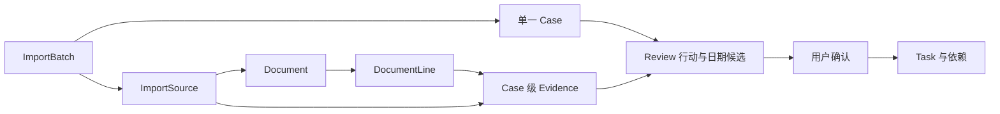
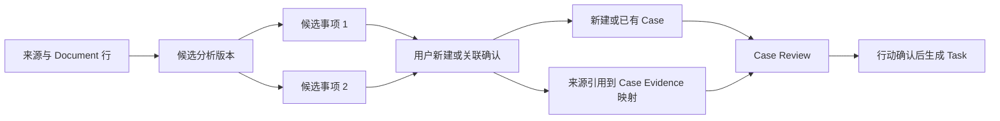

# 有绪 CampusWeave｜RF-002 来源、候选事项与 Case 契约提案

2026-11-05 提案；2026-11-06 补测；负责人 C；基线 `ac9e07c`；分支 `docs/RF-002-case-contract`。
状态：C 侧走读、关系提案和有限服务层验证已完成，待 D 共审、A/B 评审及 RF-001 共同样例确认。本文中的新字段、操作和状态均为待审建议，不是已上线 API；未修改业务代码、数据库结构或共享接口。

## 1. 已有请求链与事实

| 环节 | 源码入口 | 当前行为 |
|---|---|---|
| 输入与隐私 | `mobile/src/features/imports/ImportView.vue`、`services/privacyGuard.ts` | 文本/网页/文件及原生分享输入；上传前核对和授权，成功保存后清理本次分享快照。未实测 Android |
| 保存来源 | `features/imports/batchStore.ts::saveSources` → POST `/api/v1/import-batches` 与其 `/sources/text`、`/sources/url`、`/sources/files` | 同一批次可含多个来源；来源变更增加 batch revision；失败来源独立保留结果 |
| 附件候选 | `main.py::import_attachment_candidate` → `/sources/{source_id}/attachments` | 这是网页附件链接候选，不是候选事项。需逐项授权获取；子来源 metadata 记录 parent_source_id |
| 分析批次 | `main.py::analyze_import_batch` → POST `/api/v1/import-batches/{id}/analyze` | 一个 batch.case_id；所有成功来源汇总进单一 Case，分析前已创建 Case。同 revision 的顺序重复请求返回已有批次结果，不能据此保证并发事务幂等 |
| 文档与证据 | `services/documents.py::store_document/normalize_lines/bind_document` | 原件 Document → 行；Evidence ID 按 Case+line 稳定生成，反复绑定同 Case 不重复；同一行可生成不同 Case 的 Evidence |
| 分析与 Review | `main.py::analyze_case/_persist_analysis`、`services/review.py::save_review` | 本地抽取或可选模型，验证后保存 Case 的规则、材料和 Review；Review 中 actions 是行动步骤候选，不是多个事项候选 |
| 人工确认 | `components/AnalysisReviewPanel.vue` → `services/review.ts` → POST `/api/v1/cases/{id}/confirm` → `confirm_review` | consent、review revision、行动/日期与证据校验后，事务写 Task/依赖/截止/确认记录；资格 UNKNOWN 不因确认变 TRUE |
| 清单与日程 | `features/cases/store.ts`、GET `/api/v1/cases/{id}/plan`；D 的排程链 | Task 仍归属 Case，Evidence 同 owner/Case；通知未确认时门禁阻止执行相关写入 |



纯文本批次来源目前直接产生全文 Evidence，没有 Document/line；不能宣称所有来源已具备逐行原件定位。旧 `/imports/text|url|files` 继续独立存在，`import_case_sources` 保留旧 import→Case 关系。错误目前混合 detail 字符串和 code/message；成功通常包在 data/request_id 中。

## 2. 当前数据基数与限制

| 关系 | 代码事实 | 后续影响 |
|---|---|---|
| batch → source | 一对多；import_sources.batch_id | 批次是导入操作集合，不应充当事务业务身份 |
| batch → Case | 单一可空 case_id | 不能表达一通知多个独立事项 |
| source → Document | source_documents.source_id 主键；文件/网页通常有原件 | 不能把 metadata.document_id 当跨 owner 可直接访问的凭据 |
| Document → line | 一对多；行含 page、locator、bbox 等 | 行 ID 与文档版本绑定，不以摘录文本代替稳定 ID |
| Evidence → line | evidence_lines.evidence_id 主键 | 同一行可被多个 Case 引用，各自独立 Evidence；当前 bind_document 会绑定文档所有行，候选选行能力尚未实现 |
| Case → 补充附件 | case_attachment_documents.document_id 主键 | 同一原件不能在此表绑定两个 Case；与上面的多 Case 行证据能力不同 |
| Evidence、Task → Case | 当前均 case_id NOT NULL | 独立 Task/用户依据须与 D 协调，不能伪造 Case 绕过 |

有限实验证实：同文档两行绑定两个同 owner Case，保持 2 行、生成 4 个 Evidence；同 Case 重复绑定稳定。补充附件第二次关联另一 Case 会报 SQLite IntegrityError。这是现有表结构限制的复现，不是共享附件功能通过。

## 3. 建议的确认前后关系与最小字段

确认前保留来源和 Candidate，不为新候选创建正式 Case、Task 或通知 Evidence。建议为所有可分析来源准备稳定文档行；旧纯文本全文证据不回填假行号，原始定位缺失须明确显示。创建前引用采用独立的来源引用结构，不冒充 EvidenceRef。



| 建议实体/结果 | 最小信息（最终字段名待审） |
|---|---|
| 候选集/分析版本 | owner（由会话取得）、batch_id、batch_revision、analysis_revision、输入摘要 hash、schema_version；旧版本不可当最新确认 |
| 候选事项 | candidate_id、candidate_revision、title/category 建议、处理状态（待处理/忽略/已确认）、source_refs、候选行动/日期/材料及其引用、待核对原因 |
| 来源引用 source_ref | source_id、source_revision、document_id/document_revision、line_id、quote；有 page/bbox 就保留，无则明确为空；quote 必须与指定行匹配 |
| 处理命令 | 幂等键、版本快照、candidate_id/revision、new/existing/ignore、已有 case_id 及目标 review revision、用户授权；不能接受客户端 owner_id 来决定归属 |
| 处理结果/回执 | 每候选的处理状态、case_id 或空、source_ref→evidence_id 映射、Case review revision、是否重放；批次能表达多个 Case |

附件链接被发现不等于附件内容已获取。只有授权获取并保存原件/行后，才能为附件内容建立引用；一个附件可由多个候选显式引用，不按文件名自动判为同一原件。

## 4. 确认操作样例与六类场景

以下为语义样例，不绑定新 URL，也不是当前接口可接受的 payload。合成 ID 仅用于说明；以新候选确认操作为例：

```json
{
  "operation_id": "synthetic-confirm-01",
  "batch_id": "batch-demo",
  "expected_batch_revision": 3,
  "analysis_revision": 1,
  "decisions": [
    {"candidate_id": "candidate-award", "expected_revision": 1, "action": "new"},
    {"candidate_id": "candidate-contest", "expected_revision": 1, "action": "existing", "case_id": "case-contest", "expected_review_revision": 2}
  ],
  "consent": true
}
```

预期成功 data 包含两个候选的结果、Case ID、Evidence 映射和各 Case 的最新 Review revision。建议本次决策集合整体原子提交，任一项失败整组不写；如果需要部分成功，客户端明确分成多个操作，不静默部分提交。

| 场景/合成输入 | 确认请求意图 | 目标响应与授权/事务边界（均待实现） |
|---|---|---|
| S1 一来源两候选：通知 L1 为奖助、L2 为竞赛 | 两候选分别 new | 产生两个 Case；各自仅绑定被选内容的 Evidence；不能把两类截止和资格混到同一 Case。一个 owner、一个操作内成功或回滚 |
| S2 两来源一 Case：主通知 L1 与补充说明 L2 | 候选显式引用两来源，new | 一个 Case、两组来源证据及完整映射；冲突日期保留待核对，不按来源顺序覆盖。所有来源、行、版本均属当前 owner |
| S3 两候选共享附件 D1 | 同时 new，各显式选同附件行 | 原件不复制；每 Case 各自 Evidence；需修补补充附件关系唯一性。任一引用失效整组回滚 |
| S4 忽略一个候选 | ignore candidate-contest | 回执显示忽略、case_id 空，不写该候选 Case/Task/Evidence；保留处理记录供追溯；重开忽略需新 revision，不能修改旧回执 |
| S5 关联已有事项 | existing case-contest，携带 review revision | 复核目标 owner 与版本；追加来源/证据，旧 Task ID/status 和日程保留；新来源使 Review 待复核，不能直接把新行动加入已确认计划；不把旧截止静默替换 |
| S6 重放、变更、越权及无授权 | 同 key 重试；旧版本；其他 owner 的 Case/行；consent=false | 同 key 同内容返回原回执且不重复创建；同 key 异内容建议409；stale建议409；越权404；无授权422。失败不新增映射、Case 或 Task，其他用户资源不泄露 |

这些目标的完整 API/并发/旧库迁移用例尚未运行；不能用当前服务层实验替代验收。

## 5. 授权、版本、幂等与事务提案

1. 每次读取/写入按 owner 核对 batch、source、Document、line、candidate、目标 Case；行必须属于所声明原件，来源必须属于该批次；同 owner 跨 Case 的 Evidence 也不能直接复用为另一 Case 的引用。
2. 比较 batch_revision、analysis/candidate_revision、Document revision/hash；关联已有 Case 再核对 Review revision。分析结果必须绑定输入快照；分析期间来源改变则拒绝发布结果或显式保留旧版，不伪装最新。
3. 幂等回执建议以 owner+operation_id 唯一，并存规范化请求摘要。重放先核对请求一致性和资源访问权限，再返回已提交回执，不因本操作造成的 revision 增量产生重复副作用；新键重复处理已确认候选返回已有绑定或冲突，不能再造新 Case。
4. 候选确认事务中完成版本复核、new/existing 决策、选行绑定、附件关联、Review 待复核、处理状态与回执写入；任何一步失败回滚。网络下载、OCR 和模型请求在此之前完成，不放在数据库写锁内。
5. 保留现有 Case Review 的行动确认门禁和事务。建议首轮把“选择办理哪个事项”和“确认具体步骤/截止”明确为两个阶段；RF-016 若拟合为一次用户操作，也必须在同一事务复用 Review 校验，不跳过授权、证据、依赖、排程冲突检查。该交互取舍待 A/D 确认。
6. 新来源、日期或资料版本变化的失效范围需列明；不删除旧 Evidence/Task、不自动重排日程。既有确认失效后提示重新核对，补充通知传播的完整实现留给 RF-019。

## 6. 旧数据兼容与拟改范围

- 保留旧 batch.case_id、import_sources.evidence_id、旧 import_case_sources、Case/Evidence/Task ID 及完成状态，不按新多候选逻辑重建历史 Case。
- 已存在 batch.case_id 的批次按“历史已关联”投影为候选结果；从现有来源/Evidence 回查关系，不凭标题或全文相似自动合并。不补造模型分析版本、line 或确认同意记录；不触发重新编译 Task。
- 新批次用候选集合/绑定回执表达多对多；旧 case_id 仅作单一明确目标的兼容摘要。多 Case 时旧页面如何引导升级需先确认，不能随意选第一个 Case 给旧消费者。
- source.evidence_id 当前只是一条引用，Document 可能对应多行；新映射不能只沿用这个单字段丢失其他 Evidence。
- 建议保留 Document 与 Evidence 表，新增最小候选/处理关系；case_attachment_documents 改为 owner+case+document 关系约束的可行性待评审。迁移编号、DDL、FK、旧外键检查与回滚策略交 RF-015 详细实施，不在本卡执行。
- 独立 Task 导致的 Evidence 可空 Case 等变更由 RF-002/003 共审、RF-038/039 协调实施，禁止与 RF-015 各自产生冲突迁移。
- 影响范围：`main.py` 批次与旧入口/附件/确认、`services/documents.py` 选行绑定、`review.py` 追加来源后失效策略、`schemas.py`、bootstrap/migrations、`types/product.ts`、batchStore/进度与候选 UI、证据预览和文件消费者。这里只是影响清单，没有占用或改动这些公共文件。
- 兼容测试计划：真实旧库副本去标识后迁移前后 ID/状态对比、legacy prepare 保留任务、单批次/多候选新旧响应、owner/过期/重复/并发确认、共享原件删除保护、中途异常全回滚、旧 URL 与 Offline Demo 回归。当前仅在内存新建 schema 上验证既有迁移重放，未验证真实旧库升级。

## 7. 对 D 公共决策表的 C 侧意见（待共同确认）

唯一公共决策表仍由 D 维护，本节仅是 C 的输入，不填写已签认。核对版本：远端 `d159808`，PR #1；不修改 D 的记录。

| D 编号 | C 建议与消费边界 |
|---|---|
| Q01 | 复用唯一 Task，不造假 Case。通知 Task 必须源于已确认 Review；手动独立 Task 可无 Case，但不得伪装通知来源。首轮跨 Case 依赖不默认开放，授权与引用范围共同确认 |
| Q02 | 确认前用 source_ref，确认后映射到每 Case 独立 Evidence。无 Case 的用户依据建议仍用同一 Evidence 模型，由 D 的独立 Task 增量支持可空 Case、显式 user_input 来源及作用域校验；不能只放松 NOT NULL。排程若沿 Task 回查依据，响应至少给 task_id 和受控解析路径/缺失状态；是否显式 refs 待定。资格沿现有 relevance、relevance_reason、missing_profile_fields、missing_case_fields 输出，UNKNOWN 不由排程模块重判 |
| Q03 | 通知取消/忽略候选不是“前置任务实际完成”。建议必要依赖的 skipped 默认不视为完成，豁免需明确用户决定及依据；当前 solver 将 skipped 放行，需 D/A/B 确认兼容方式后改，不能把建议写成现状 |
| Q04 | 单片日程完成不自动将整个通知 Task 完成；保持清单与执行时间分离 |
| Q05 | 先展示关联影响再删除/解绑，不级联删 Vault/Document 原件。仍被任一 Case/证据/草稿使用的原件受保护；已安排任务删除需与 D 确认日程保留/取消和提醒撤销，B 确认草稿引用 |
| Q06/Q07/Q08 | 未知耗时明确标未确认；新空选择不变全选且保留旧缺省兼容；预览与提交统一时区/截止口径，过去时间不能静默保存。具体字段和行为采用 D 决策表定稿，不另造排程协议 |
| Q09/Q10 | 原生提醒由 D/A 验证；错误包络兼容现有字符串，新增契约另经评审，不重写 OpenAPI 基准。迁移顺序由 A/B 协调 |

## 8. 通知首批依赖与验证边界

- RF-001 的 C 走读与共同样例 → RF-002/003 共同确认。
- RF-002 定稿 → RF-015 候选存储与来源关系；RF-008+002 → RF-014 候选 DTO/分析；两者具备后 RF-016 原子确认 → RF-017 UI。RF-018 去重基于已确认关系，不先自动合并。
- RF-001 后可按首个通知消费者需要研究 RF-008 Mock 兼容增量；涉及公共 Provider 先评审。RF-013 可先选明确导入失败路径，但样本和共享约定需具备。
- RF-011 文件引用与 RF-012 有效资料/经历读取边界 → RF-020 材料要求 → RF-021 匹配；不得在本卡新增材料存储或填表服务。RF-019 传播待消费者版本稳定。
- 初次服务层实验 8 项通过；2026-11-06 解决本地依赖获取问题，补测29项定向API/服务测试、真实HTTP启动及OpenAPI基准均通过。命令、失败历史和范围见 [C 工作记录](C_notice_case.md)。这些验证针对既有基线，不证明多候选API已实现；Web、Android、在线模型、真旧库迁移、并发确认仍未验证，公共契约仍待共同确认。

## 9. 2026-11-09 C 对 PR #3 的逐项评审

基线 `ce597a1`。以下意见对应 [PR #3](https://github.com/Hanxx1/RuleFlow/pull/3) 的 C 清单和 [D 契约第 7 节](D_RF003_contract.md)。供 D 汇入[公共决策表](D_public_interface_questions.md)，团队定稿待相关成员确认。

| 条目 | C 的评审意见 |
|---|---|
| Q01 Task 来源与归属 | 接受。服务端从创建路径确定 origin，case_id 单独表达归属。导入通知的行动由确认 Review 产生。现有 create_task 在事务内调用 require_confirmed，Case 内手动新增仍须保留这道检查，来源记 user_input。旧任务保留 ID/status，来源无法证明时记 legacy_unknown。 |
| Q01 独立入口与依赖 | 接受。RF-040 清单沿用同一 task_id。独立创建与内容编辑分开，旧状态 PATCH 保持原语义。首轮仅允许同 owner 独立任务之间、或同一 Case 内建边，跨 Case 与混合依赖拒绝且无写入。已有安排时，约束变更冲突应提示用户先处理安排。 |
| Q02 候选与 Evidence | 接受。确认候选时核对来源行、版本和 owner，把 source_ref 映射为各 Case 自己的 Evidence。确认行动后才生成通知 Task。独立用户依据必须绑定当前独立 task_id，即使 owner 相同也不能借用别的任务依据。 |
| Q02 排程与资格 | 接受显式 evidence_ids/evidence_state 加受控任务回查。旧响应缺字段或引用失效时显示“待核对”。C 输出 relevance、relevance_reason、missing_profile_fields、missing_case_fields，D 原样消费。依据有效和资格成立是两个判断，用户确认时间安排时保留 UNKNOWN 和待补字段。 |
| RF-043 交叉审查 | 接受 S01/S04/S20/S21 的 10 项测试作为既有行为的回归依据。S01 检查准确时段且预览零写入。S04 区分外部前置足量与完全缺失。S20 检查非法窗口零写入及默认 14 天。S21 在第二次校验时观察到第一条已写入，注入 409 后正式日程为空、草案 pending 且 committed_at 为空，同一草案重试保存两条。S03 的部分前置耗时、S05 的过去窗口、S07 的纯日期时区差异仍开放。 |

**供 D 复用的合成样例（预期，未执行）**。同一通知 L1 要求先核对材料再提交，L2 写明提交截止为 2026-11-20 17:00 +08:00，L3 要求核对成绩资格。确认 Review 后生成 T1 核对材料、T2 提交，T1→T2。用户估计 T1 需 90 分钟，为 T1 只安排了 30 分钟。仅选 T2 时，预览和提交均应提示前置耗时不足。缺少成绩时保留 UNKNOWN 和对应待补字段。时长依据来自用户，截止依据来自 L2。

**与 B 的 RF-028 移交提议（待 B 确认）**。B 分支 `62ec31a` 已按附件分配规则。对于已保存的通知，建议 C 提供当前用户获准读取的来源及版本、原文行和附件 Document 引用，B 用用户选中的原件及模板指纹确认适配版本。共享原件的两个 Case 各持自己的 Evidence。引用失效或附件版本变化时提示重新核对，待双方核实旧纯文本无 Document 的处理方式。

### 11 月 20 日 RF-015 与 RF-038/039 迁移核对

Q01/Q02 的核心语义已形成共识，沿用上表。通知候选确认后映射为各 Case 的依据；独立 Task 的依据限定到当前任务，同一 owner 的其他任务也不能借用。接下来只核对表、迁移负责人和依赖顺序。

| 现有表或关系 | C 侧 RF-015 建议 | D 侧 RF-038/039 涉及的范围 |
|---|---|---|
| `evidence` | 候选到各 Case 的映射引用 Evidence ID。建议 RF-015 在新增关系中保存映射，避免两边分别重建此表 | 现有 `case_id` 必填。独立任务需要支持无 Case、绑定当前 Task 及按作用域读取；实际字段或关系表由 D 列出。此处是主要潜在 DDL 冲突 |
| `tasks` | 保留旧 Task ID、状态和 Case；候选存储无需改此表 | 当前 `case_id` 必填。D 负责独立创建所需的归属和来源兼容，复用旧任务测试核对状态更新 |
| `import_case_sources`、`case_attachment_documents` | C 负责旧批次到 Case 的兼容和同一原件跨 Case 的关系。核对现有主键能否表达一对多，再确定新增映射或调整约束 | 当前未识别 D 对这两张表的改表需求；如需读取作业原句，先核对引用和归属 |

**供 A/B 确认的顺序**：C/D 先分别列出拟改表、外键和旧数据检查项。若 RF-015 采用独立映射表，可与 D 的旧任务兼容验证并行；若两边都需改 `evidence`，建议由 D 集中提交共享表迁移，C 核验旧 Case 依据和文档行引用，再接依赖新结构的映射。最终由 A/B 协调确认实际范围和先后，D 回写[公共决策表](D_public_interface_questions.md)。本节未分配迁移编号。

### 11 月 22 日 RF-015 迁移对照与验收输入（C 草案）

核对基线 `3bcd0d7`，D 侧以已有 [Q01/Q02/Q10 和迁移影响清单](D_public_interface_questions.md) 为准。下表用于范围和顺序评审，列出的关系名为业务用途，具体表名、约束和迁移编号待确认。

| 范围 | RF-015 建议 | RF-038/039 与兼容检查 |
|---|---|---|
| 候选、来源、Case 映射 | 新增候选存储及版本、候选处理结果和来源到 Case Evidence 的映射。确认前仅存来源引用；RF-016 确认后，各 Case 分别获得自己的 Evidence。校验同 owner、批次与文档行归属，拒绝过期版本。 | 候选存储可与 D 的兼容基线并行准备。独立 Task 使用自己的依据作用域，接入前核对 D 的读取契约。 |
| `import_batches`、`import_case_sources`、`source_documents` | 保留旧批次的单值 `case_id` 和旧导入映射。新多 Case 关系由新增映射表达。`import_case_sources` 的主键是 `import_id`，它与 `import_batches` 不是同一入口。`source_documents` 继续保存来源到原件的关联。 | 升级副本逐项比较旧 ID、owner、Case、来源状态和已存 Evidence ID。旧粘贴正文没有行引用时保持原状。 |
| `evidence` 与直接引用 | RF-015 建议引用既有 Case Evidence，保持 ID 和 Case 归属，不重建该表。内存实例确认 `import_sources.evidence_id`、`evidence_lines.evidence_id`、`knowledge_evidence_sources.evidence_id` 均为直接外键，删除行为为 `NO ACTION`。 | 如果 D 的方案需要重建 `evidence`，上述三条外键及旧证据的 Document/行关系须一起验收。规则、材料、Task、截止与附件中的依据字段或 JSON 还要做业务对照，`foreign_key_check` 不覆盖它们。 |
| `case_attachment_documents` | 现有主键 `document_id` 阻止跨 Case 复用同一补充附件。共享功能建议采用 owner＋Case＋Document 的关系键，保持每个 Case 的证据归属，并同步核对 Case 资源读取、原件删除保护、重复关联。 | D 未提出修改此表。此项可按共享附件实际依赖单独评审。旧附件关系及原件哈希应保持；解绑一个 Case 后，另一 Case 的引用仍可读取且原件仍受保护。 |
| `tasks` 与关联 | RF-015 不改 Task 结构，继续保留现有 Review 门禁及 Case Task ID。 | 内存实例确认 `task_material_links`、`vault_task_links`、`schedule_items` 指向 `tasks.id`。复用 D 的 11 表基线核对状态、材料、Vault、正式日程、任务依赖及排程设置，再按最终方案验证独立 Task。 |

**建议合并顺序。** A/B 先确认 Q01/Q02/Q10 和实际改表归属。若 RF-015 的候选基础仅新增独立关系，且无需调整 `evidence`，其可独立评审和合并。若须改 `evidence`，建议单一迁移负责人提交共享表变更，C/D 分别签认旧通知与 Task 兼容，由依赖该结构的映射和接口随后落地。共享附件约束变更按确认过的依赖进入对应 PR。

**升级验收草案。** 复制隔离旧库，同时保留配套 Document 原件和 Vault 文件。升级前后比对旧批次/来源/Case/证据/文档行键、owner、原文、引用和文件哈希，以及 D 的 Task 关系基线。运行 `PRAGMA integrity_check` 和 `PRAGMA foreign_key_check`，并回放旧通知 Review 门禁、旧 Task 状态更新和原件读取。新路径需覆盖一来源两候选、同原件两 Case 各自 Evidence、越权及过期零写入、重试无重复记录和事务失败回滚。D 请核对依赖的证据作用域及拟改表，B 请核对填表和资料的引用消费，A/B 确认合并顺序。尚未运行候选迁移。

### 11 月 23 日 RF-015 迁移前实测与实施边界

继续复用 `docs/RF-015-migration-review` 及原草案。本地基线 `3bcd0d7`；fetch 后远端 main 为 `ce3ecd4`，两者仅 C 文档／样例不同，生产源码与主线一致。原工作区的任务表补记和 RF-013 RED 测试保持原状，不纳入本切片。Q10 在 D 的唯一公共表中仍待确认，以下不是新的共同签认或迁移授权。

新增 [C 来源兼容基线](../../../server/tests/test_notice_migration_baseline.py)，与 D 的 [旧 Task 基线](../../../server/tests/test_legacy_case_task.py)及[关联校验测试](../../../server/tests/test_legacy_task_link_checker.py)配套：

| 检查 | 实际范围与结果 | 不能据此声称 |
|---|---|---|
| 两类现有导入关系 | 用真实旧文件入口和批次文本＋文件入口建立合成通知。批次分析后 `case_id`、来源 Evidence 与 Document 行关系均真实产生；多行 Document 有两条 Evidence，source 单值仅指首条 | 已有候选持久化或旧批次已自动升级为多候选 |
| 副本初始化重放 | 文件 SQLite backup，加上独立目录中的原件复制；重放现有 database 两次，逐行比较 20 张显式表（含迁移记录、Review、规则／材料／Task 与 JSON 引用），完整性及外键检查通过 | 新 RF-015／RF-038 迁移已通过；备份过程并发一致性已验；比较范围包含所有业务表 |
| 读取与门禁 | 副本原件内容／hash 与原件一致，其他账户读取拒绝；两类通知未确认 Review 时创建 Task 均为409，最后表快照仍一致 | 新候选确认事务、真实模型或真机闭环通过 |
| 原件跨 Case 的依据绑定 | 调用现有 bind_document：两个 Case 使用同两条原行，各有不同 Evidence ID；重复绑定不增记录 | `case_attachment_documents` 已支持共享附件；服务层绑定不等于补充附件 API 共享能力 |

**拟交付与合并边界（供 D/B/A/B 核对）：**

1. RF-015 基础只计划新增候选集合／版本、来源快照及结果映射；确认前不创建正式 Case、Evidence 或 Task。不回填虚构候选分析版本，不将现有 source 单 Evidence ID 当完整行映射。候选表实际字段、主键、外键及快照指纹仍待确认；不分配迁移编号。
2. RF-038/039 的 Task 可空 Case、依据作用域及内容版本由 D 提拟改 DDL。若只读现有 Case Evidence，RF-015 可独立；若引用新作用域字段或需重建 Evidence，则先合单一负责人提交的共享迁移，再合依赖结构的关系／接口。双方不能各自重建 Evidence。
3. 共享补充附件关系单列小切片：确认现有 document_id 主键的变更、资源读取、解绑及原件保护后实施；不能将本轮 bind_document 用例算作该项验收。
4. RF-016 的确认事务、操作回执、失败回滚及 Review 失效必须作为后续明确切片；若 RF-015 只落存储，不预写「已确认」或伪资源 ID。新旧响应由 Q10 评审，不任取首个 Case 给旧客户端。

**待团队提供的具体结论：**D 列 Task/Evidence 实际拟改字段／关系及插入顺序、是否重建共享表；B 核对来源和完整 Evidence 映射的消费及失效处理；A/B 确认共享迁移负责人、拆分范围、回滚方式和合并先后，并由 D 回写唯一公共表。现有初始化重放基线可以先审，不替代上述确认。

本轮定向 38 项通过；未执行新迁移、真实旧库升级、并发备份、候选 API 或全量回归。未来迁移实码就绪后，须对复制的迁移前数据运行升级，并再次核对上述关系和 D 的 Task/Vault 基线；本轮合成数据创建于当前 schema，不能冒充历史 schema 升级样本。
